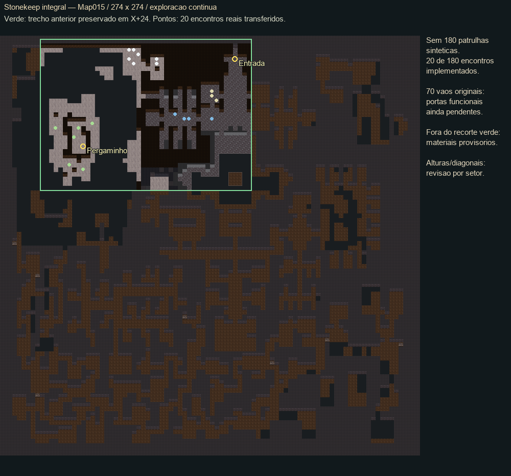
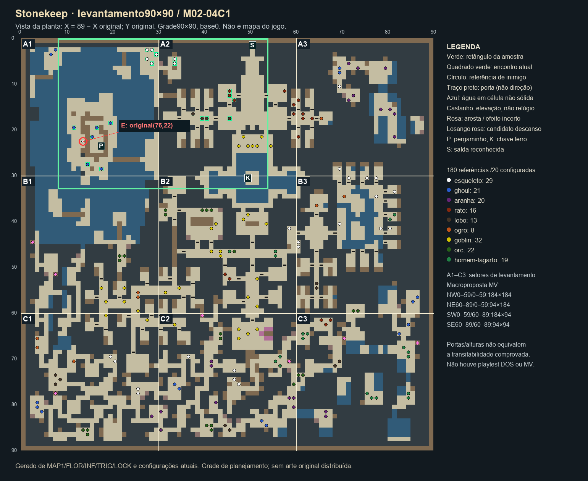

# M02-04 — amostra integrada de Stonekeep

## Matriz operacional de assets — nove espécies

**Organização aprovada:** preparar por dungeon, uma espécie por entrega e avaliação antes da próxima; quando ambos faltarem, combate e caminhada juntos. [Regra principal](DIRECAO_DE_ARTE.md#preparação-de-inimigos-por-dungeon--organização-aprovada). Totais abaixo são as180referências MAP1→STKEEP1.INF do levantamento completo, não encontros DOS observados ou distribuição já implementada. Reuso entre dungeons exige correspondência nas fontes. Cobertura Map015 atual: **180/180 encontros registrados e 70/70 portas**; as inspeções RAM do orc e do homem-lagarto não entram nessa contagem.

| Espécie / flat / total original | Combate | Caminhada | Aprovação/cobertura conhecida | Próxima dependência de assets |
|---|---|---|---|---|
|Rato /52 /16 |Disponível R02 |Disponível R02 |Combate R02 aprovado (associação a61977b); exploração e entrega M01 preservadas, sem nova aprovação específica inferida |Reutilizar; nenhuma geração necessária agora |
|Goblin /53 /32 |Disponível R03 |Disponível R02 |Legado da entrega M01; não inventar aprovação artística individual nova a partir de testes gerais |Reutilizar; manter ressalvas/evidências M01 |
|Homem-lagarto /54 /19 |**Aprovado R03** |**Aprovado V01** |Aprovação explícita posterior à entrega8b309cc, sem equilíbrio/recompensas/distribuição |Reutilizar; dezenove registros distribuídos |
|Lobo /55 /13 |Disponível V01 |Disponível V01 |Animação/combate aaea451 e patrulha d27eb5f aprovados; conjunto ampliado/manual posterior adiado |Reutilizar; sem novo lote |
|Orc /56 /22 |**Aprovado42b857f** |**Patrulha6794a81 aprovada** |Aprovações explícitas de combate e patrulha; sem ampliar a equilíbrio/recompensas/encontros |Reutilizar; vinte e dois registros distribuídos |
|Esqueleto /57 /29 |Disponível V01 |Disponível V01 |Combate/visual f198987 e patrulha6956516 aprovados; funcionamento do grupo relatado em443e43b, sem testes específicos presumidos |Reutilizar |
|Minotauro /58 /8 (alias OGRE.DFA) |**Aprovado V01** |**Aprovado V01** |Aprovação explícita de combate e patrulha569e382; sem balanceamento/recompensas/distribuição |Reutilizar; oito registros distribuídos |
|Aranha /59 /20 |**Aprovado com ressalva** |**Aprovado com ressalva** |f5ebdba: preferência pela primeira geração de batalha; [revisão futura](ARANHA_M02.md), ativa preservada |Reutilizar; vinte registros distribuídos |
|Ghoul /60 /21 |Disponível V01 |Disponível V01 |Batalha8ea06c9 aprovada; ghoul na ilha99203b2 e coleta relatados funcionais, sem aprovação de equilíbrio/persistência por inferência |Reutilizar |

**Sequência vigente.** Stonekeep está disponível para avaliação pela campanha. O levantamento M02-03E1 está documentado. O próximo recorte de conteúdo é M02-03E2, ligar o portão urbano à corte com os recursos existentes. Balanceamento fica para depois da avaliação do percurso.

## Stonekeep na campanha — integração de 10/11/2026

A estrada de Rihad usa o Map015 depois de aceitar o pedido de Blubamka. A saída de Stonekeep retorna à esplanada. A coleta e a entrega do pergaminho conservam a fonte `stonekeep.parchment`, o item 7 e o recibo `MQ02.rihad.parchment`. Os contratos de origem do Map012 continuam disponíveis para reconstrução e laboratórios antigos. A campanha resolve a mesma área lógica para o Map015. O hub RAM continua disponível para diagnóstico.

### Matriz vigente

| Setor | Encontros registrados | Alcançáveis no grafo | Portas alcançadas |
| --- | ---: | ---: | ---: |
| A1 | 14/14 | 14 | 0/0 |
| A2 | 19/19 | 19 | 13/13 |
| A3 | 19/19 | 7 | 5/5 |
| B1 | 10/10 | 10 | 4/4 |
| B2 | 25/25 | 25 | 18/18 |
| B3 | 20/20 | 20 | 20/20 |
| C1 | 19/19 | 19 | 6/6 |
| C2 | 32/32 | 32 | 4/4 |
| C3 | 22/22 | 19 | 0/0 |
| **Total** | **180/180** | **165** | **70/70** |

A base 9c9b802 tinha 119 encontros e 46 portas. A extensão começa por C3 central/Y70–74, pela passagem seca MIF 30↔29/Y73 (MV 181↔182/Y222), completa C3 e segue pelas conexões de B3 e A3. Os 61 encontros e as 24 portas foram anexados aos IDs anteriores. Posições, espécies, eixos e LOCK foram conferidos no MIF/INF. Doze grades PORTCULS usam provisoriamente as portas existentes. Cinco LOCK de B3 reutilizam a ação de forçar, conforme o nível declarado. [Fonte das alas leste](mapas/STONEKEEP_ALAS_LESTE_M02.json)

A auditoria abre cada porta a partir de um lado já alcançável e respeita as fechaduras. Usa passabilidade nativa, considera as portas fechadas como bloqueios e desconsidera ocupação de patrulhas para medir a topologia. As rotas excluem volumes aquáticos incertos. Permanecem 12 encontros registrados num componente de A3 e três na sala C3 de MIF (14,77), (12,78) e (13,78), sem ligação comprovada no modelo atual. O grafo confirma a saída e o acesso ao pergaminho. A lista de IDs pendentes está no contrato das alas leste. As alturas e diagonais próximas precisam de evidência adicional antes de mudar colisões. O relato da porta sem localização continua aberto.

### Provisões, saves e verificação

Os 17 tesouros acessíveis correspondem aos ITEM2–8 de STKEEP1.INF, incluindo pilhas, equipamento, corpos e baús. Usam a tabela aprovada de tesouros e a reserva de 2–8 moedas quando a rolagem vier vazia. O recibo é individual por coordenada. Os baús usam a interação de tesouro existente, sem fechadura específica de baú. Quatro tesouros de A3 ficam pendentes de acesso. A chave de ferro de MIF (40,30) continua opcional e seu vínculo com uma fechadura específica segue sem confirmação.

Seis plataformas secas acessíveis do tipo 0x1808 usam o descanso autorizado. MIF (50,60) é o sétimo candidato e aguarda comprovação de acesso. Recuperação ocorre por interação e preserva derrotas, quest e recibos. Balanceamento de provisões e encontros fica para depois do teste integrado.

Ao carregar um save normal dentro do Map012, o jogo abre o Map015 e traduz a posição em X+24. Se a posição cair sobre um bloqueio ou evento, usa a entrada de Stonekeep. A troca de mapa durante a retomada preserva o estado lógico, sem registrar uma saída. O arquivo do slot só muda ao salvar. Saves fora de Stonekeep usam o Map015 na próxima viagem. Os laboratórios permanecem isolados em RAM.

A automação em Chrome usa uma chegada sintética de nível 2, interações normais de MQ02 e slots descartáveis. Confere cobertura e acesso, persistência do delta, ida e volta a Stonekeep, entrega do pergaminho e retomada de um save sintético gravado pelo roteamento anterior. A vitória amostral e a velocidade de deslocamento foram controladas. [Evidências da integração](evidencias/m02-stonekeep-campanha/resultado.json)

### Candidata de promoção pelo Git Flow

Fonte funcional congelada `f27fd349ec49404a51e90fbd83d029d83ca0aa2b`. Bases verificadas `develop=85940d4723956079f920d7332f68a9d5a2d75641` e `main=df539eeee2d88199312ca3a8cba98edd2b2b900b`. `main` é ancestral de `develop`, que é ancestral da feature. São **74 commits de M02** e **744 arquivos** em cada diff de merge da fonte funcional. `git merge-tree --write-tree` com cada base produziu a mesma árvore da candidata, `d3bd36338595bbd71dad4c53cb7bcbfe216a8f27`, sem conflito. O delta funcional não altera o motor MV nem o workflow do Pages. A presente revisão editorial permanece na mesma feature.

| Classe | Dependências e decisão de integração |
| --- | --- |
| Campanha e dados compartilhados | Continuação e registro de áreas/quest `91bad86`/`4ff291a`, chegada/arredores/visão/corte `b8738b9`…`fe99ac3`, fontes, água e item 7 a partir de `29e38db` (inclui diagnóstico e correção de cache), entrega e recibo `4357999`, base e gerador Map015 `8f28207`, materiais, encontros, nove espécies e dados de combate, cobertura/provisões/roteamento `babb12d`…`b296bb5`. O mesmo Map015 atende campanha e inspeção técnica. Map012 preserva a base do gerador e dos testes antigos. Não promover só os quatro commits finais sobre M01 |
| Conteúdo de jogador já visível | Abertura/título aprovados `a39d71e` e `901dfcb` estão no histórico e entram no pacote do jogador. Textos da campanha em Rihad e no retorno do pergaminho também entram. Em etapa 60 a descoberta de Fang Lair está registrada, mas a viagem permanece indisponível |
| Desenvolvimento e experimentos | Hub `d800a8f` e inspeção RAM, Map014 da prova `1bcf1f9`, Map013/amostra isolada de Fang Lair `af17b4b`, E05 herdado, fixtures, servidor local `60f969b` e geradores. O perfil padrão desabilita o hub. O allowlist ainda inclui mapas/dados/plugins técnicos necessários ao boot ou compartilhados. Guardar uma revisão específica se a distribuição precisar removê-los fisicamente. Referências e estudos ficam fora do pacote |

**Prova da embalagem para jogador.** `node tools/build-web-package.cjs` e `node tools/check-web-package.cjs dist/web/m01-rc1-f27fd34/Arena` passaram em Windows com **385 arquivos de runtime**, 49.086.616 bytes com manifesto e namespace `arena:m01:save-v1`. SHA-256 do manifesto `8063e4e1c788c096a118035ab3f2ac0b62be3ea8a1467fe9af51dba926c86274`. Em origem descartável `/Arena/`, Chrome 157 abriu sem erro JS/HTTP e apresentou só Novo Jogo, Continuar e Opções, com hub desabilitado e armazenamento inicialmente vazio. O rótulo `m01-rc1` vem da receita vigente e identifica apenas a prova local nesta tarefa. Definir rótulo de candidata próprio na preparação de release. O percurso integrado e a retomada de saves continuam sustentados pelas evidências abaixo, sem repetir a campanha.

**Sequência para promover após o aceite.**

1. Confirmar o [roteiro integrado](#roteiro-de-avaliação-no-navegador) no SHA funcional e aceitar as ressalvas da matriz, incluindo acessos opcionais, grades provisórias e limite de Fang Lair. Investigar a porta relatada se o teste a localizar e identificar impacto na rota. Atualizar a evidência na feature.
2. Conferir referências remotas e o diff. Integrar a feature revisada em `develop`, preservando o histórico. Repetir a comparação de runtime e o teste focal se a árvore da candidata mudar.
3. Em uma etapa autorizada de estabilização, preparar `release/<versão>` a partir de `develop`, conferir o pacote de jogador e usar a release branch para promover a `main` pelo Git Flow, com retorno de correções a `develop`. O recorte termina na entrega do pergaminho e não constitui fechamento de M02.
4. Tratar tag/GitHub Release e publicação no Pages em decisões próprias. Pages segue manual, pelo SHA completo da versão escolhida. Uma mudança de branch não é autorização de deploy.

### Roteiro de avaliação no navegador

1. Abra o [Arena local](http://127.0.0.1:8774/) e carregue uma partida anterior à entrega do pergaminho ou use **Novo Jogo**. Se chegar a Rihad no nível 1, use os encontros dos arredores para ganhar experiência. No nível 2, descanse na esplanada para ouvir Ria, fale com o informante e aceite o pedido de Blubamka na corte.
2. Na esplanada, aproxime-se da estrada ao sul e interaja sobre o ponto de saída. Escolha **Viajar para Stonekeep**. Explore os aposentos e a passagem dos esqueletos, atravesse a água até a ilha e recolha o pergaminho. Abra um tesouro, use um refúgio com recursos gastos e salve em um slot de teste. Recarregue para conferir posição, recursos, recompensas e derrotas.
3. Volte pela saída junto à entrada, retorne à corte e entregue o pergaminho a Blubamka. Confira a conclusão da etapa no diário e o recibo único ao falar novamente. Se uma porta impedir a passagem, registre o lugar e a ação que antecedeu o bloqueio para reproduzir no hub existente.

A avaliação manual precede a promoção. A revisão de balanceamento fica após o teste integrado. O próximo recorte de conteúdo usa a [planta reconstruída de Rihad](CHEGADA_RIHAD_M02_03A.md#m02-03e1--planta-reconstruída-e-inventário-visual).

## Histórico — C2 sul Y80–89

Sobredd2c3b8; [contrato/fonte](mapas/STONEKEEP_C2_SUL_M02.json), `tools/inspect-stonekeep-c2-south.py`. Original39699021.MIF relido, hash4eb604e…7d45b preservado; MAP1/FLOR e vínculos STKEEP1.INF conferidos com o inventário. Dez referências confirmadas, nenhuma porta/LOCK nessa faixa. TRIG32,81/255,18 e46,81/255,18 preservados como dados, sem novos eventos ou condições inferidas. Sem nova observação DOS. Coordenadas originais zero-based → vista=(89−X,Y) → Map015=(3+3vistaX,3+3Y).

|Encontro |MIF → Map015 |Evento |
|---|---|---|
|Aranha |(30,80)→(180,243) |526 |
|Aranha |(59,81)→(93,246) |527 |
|Ghoul |(37,83)→(159,252) |528 |
|Ghoul |(36,84)→(162,255) |529 |
|Lobo |(45,84)→(135,255) |530 |
|Orc |(48,84)→(126,255) |531 |
|Orc |(49,84)→(123,255) |532 |
|Lobo |(44,85)→(138,258) |533 |
|Orc |(48,85)→(126,258) |534 |
|Aranha |(59,85)→(93,258) |535 |

IDs `stonekeep.c2s.enemy.mifXX.YY`, origens/eventos ocupados recusados. **119/180encontros e46/70portas**, restam61/24. C2=**32/32encontros e4/4portas inventariados**, com verificação de uma única entrada por coordenada original. Isso não conclui geometria, alturas ou demais eventos/sistemas; avaliação manual permanece adiada. Os525eventos/109encontros anteriores, todas as portas e **todas as camadas do mapa** permanecem iguais. Nenhuma correção de conexão ou colisão foi necessária.

### Circulação, configuração e limites

As rotas reutilizam corredores de C2 central/sul e ligações já existentes com C1 quando necessárias para contornar as salas; sem atalhos, transferências internas ou alteração de água/parede. A prova de rota exclui água com MAP1 não vazio, mantendo intactas as dúvidas de A1/MIF67,26. Pergaminho, quest, recibos e condições de acesso preservados; sem obrigação de eliminar todos.

Aranha9/Troop10, Ghoul5/6, Lobo6/7 e Orc7/8, mesmos assets/patrulhas/configurações de campanha. Raio2/intervalo90/região4; sem novas mecânicas. Potencial560EXP (3×80+2×75+2×25+3×40), valores existentes/provisórios para M02-BAL. Nenhuma tabela de recompensas, descanso ou balanceamento foi revista. Laboratórios mantêm suas recompensas técnicas e isolamento anteriores; ressalvas artísticas e comparação futura da aranha preservadas.

### Evidências e inspeção

[Sete grupos focais](evidencias/m02-stonekeep-c2-sul/resultado.json), Chrome isolado: boot/IDs/bloqueio de slots;4pontos do hub; circulação até os10encontros vivos e retorno a C2 central; patrulhas secas válidas;10contatos por teclado/troops corretos/bloqueio de transição duplicada; vitórias controladas/retorno/10derrotas/recibos/560EXP e repetição de chamadas sem concessão; guardar/carregar RAM reconstrói eventos a partir de array anterior e preserva derrotas/recibos/portas/quests/inventário/recursos/pontos, retorno de área sem respawn. Reconstrução idempotente e comparação de dados/assets/camadas passaram; as32origens de C2 são únicas. Movimento acelerado e vitórias/RNG controlados só na verificação; sem campanha completa/editor/mobile ou nova aprovação manual presumida.

**http://127.0.0.1:8774/ → Testes / Debug → Campanha e mapas → Stonekeep · base integral (RAM)** → Esc → **Stonekeep: pontos da base integral** → **C2 sul · aranha leste / aranhas oeste / ghouls / lobos e orcs**. Guardar/Carregar teste usa RAM, slots pessoais bloqueados, namespace e saves pessoais intocados. [Captura](evidencias/m02-stonekeep-c2-sul/aranhas.png). Servidor existente reutilizado e ativo; encerrar pelo procedimento `tools\arena-local.cmd stop`.

**Porta relatada sem localização permanece pendente**, sem causa/correção presumida. Próximo bloco contíguo proposto: **C3 central/Y70–74**,4referências (lobos MIF20,70 e21,71; orcs28,73 e29,73), nenhuma porta nova; conferir ligação seca MIF29↔30/Y73 e circulação antes de configurar. A conexão potencial C2/C3 em Y81–82 inclui água e não foi liberada por suposição; não é necessária à recomendação do primeiro bloco seco. Loot/descanso continuam posteriores aos encontros/portas, sem implementação automática.

## Entrega anterior — C2 central Y75–79

Sobred216471; [contrato/fonte](mapas/STONEKEEP_C2_CENTRAL_SUL_M02.json), `tools/inspect-stonekeep-c2-central-south.py`. MIF39699021/MAP1/FLOR e associações STKEEP1.INF relidos/comparados ao inventário, hash4eb604e…7d45b preservado. Sete referências confirmadas, nenhuma porta/LOCK nessa faixa; TRIG preservados como dados, sem novos eventos ou condições inferidas. Sem nova observação DOS. Coordenadas MIF zero-based → vista=(89−X,Y) → Map015=(3+3vistaX,3+3Y).

|Encontro |MIF → Map015 |Evento |
|---|---|---|
|Orc |(30,75)→(180,228) |519 |
|Esqueleto |(42,75)→(144,228) |520 |
|Ghoul |(56,75)→(102,228) |521 |
|Ghoul |(55,76)→(105,231) |522 |
|Aranha |(30,78)→(180,237) |523 |
|Aranha |(31,78)→(177,237) |524 |
|Aranha |(47,79)→(129,240) |525 |

IDs `stonekeep.c2c2.enemy.mifXX.YY`; origem/ID ocupado é recusado antes da geração. **109/180encontros e46/70portas**, restam71/24; C2=22/32encontros e4/4portas inventariados. Contagem não conclui geometria ou demais eventos/sistemas. Os518eventos/102encontros anteriores e todas as portas/camadas/colisões permanecem iguais, incluindo os seis encontros deY70–74. Nenhum novo asset, atributo, ação, tabela de loot, regra de descanso ou condição de acesso.

### Circulação e configuração

Reutiliza os corredores entre C2 norte/central; algumas aproximações usam salas/corredores existentes atéY85, sem novos eventos fora deY75–79, alteração de parede ou transições internas. A prova de rota exclui água com MAP1 não vazio, mantendo pendências de A1 e MIF67,26 inalteradas. Sem obrigação de eliminar todos para avançar ou coletar o pergaminho.

Orc7/Troop8, Esqueleto4/5, Ghoul5/6 e Aranha9/10, raio2/intervalo90/região4, mesmos assets e configurações de campanha. Potencial480EXP (40+50+2×75+3×80), valores existentes/provisórios para M02-BAL, sem revisão de balanceamento. Laboratórios conservam sua separação e recompensas técnicas; evidências de isolamento anteriores reutilizadas, sem novo teste artístico/combate completo. A ressalva visual da aranha permanece futura, ativa e mestres preservados.

### Evidências e acesso

[Sete grupos focais](evidencias/m02-stonekeep-c2-central-sul/resultado.json), Chrome isolado: boot/IDs/bloqueio de slots;4pontos do hub; circulação nativa até os7encontros vivos e retorno às áreas anteriores; patrulhas secas válidas;7contatos individuais por teclado/troops corretos/bloqueio de transição repetida; vitórias controladas/retorno/7derrotas/recibos/480EXP e repetição de chamadas sem nova concessão; guardar/carregar RAM reconstrói eventos de array anterior e preserva derrotas/recibos/portas/quests/inventário/recursos/pontos, retorno de área sem respawn. Reconstrução idempotente, comparação de dados/assets e camadas idênticas passaram. Movimento acelerado e vitórias/RNG controlados só na verificação; sem campanha completa, editor/mobile ou nova aprovação manual presumida.

**http://127.0.0.1:8774/ → Testes / Debug → Campanha e mapas → Stonekeep · base integral (RAM)** → Esc → **Stonekeep: pontos da base integral** → **C2 central sul · orc e aranhas leste / esqueleto / ghouls / aranha oeste**. Guardar/Carregar teste usa RAM; slots pessoais bloqueados, Map012 e namespace preservados. [Captura](evidencias/m02-stonekeep-c2-central-sul/aranhas.png). Servidor existente reutilizado, permanece ativo; encerrar pelo procedimento `tools\arena-local.cmd stop`.

Testes manuais continuam adiados. **Porta relatada sem localização permanece pendente**, sem causa/correção presumida. Próximo bloco contíguo proposto: **C2 sul/Y80–89**,10encontros (3aranhas,2ghouls,2lobos,3orcs), sem portas novas; conferir posições/conexões antes de configurar. Loot/descanso continuam posteriores aos encontros/portas; não iniciar outra melhoria automaticamente.

## Entrega anterior — C2 central Y70–74

Sobre09b6ed7; [contrato/fonte](mapas/STONEKEEP_C2_CENTRAL_M02.json), `tools/inspect-stonekeep-c2-central.py`. MIF39699021/MAP1/FLOR e associações STKEEP1.INF relidos e comparados ao inventário, hash4eb604e…7d45b preservado. Seis referências confirmadas, nenhuma porta/LOCK na faixa. TRIG54,71/255,19 preservado como registro, sem novo evento ou condição inferida. Sem nova observação DOS. Coordenadas MIF zero-based → vista=(89−X,Y) → Map015=(3+3vistaX,3+3Y).

|Encontro |MIF → Map015 |Evento |
|---|---|---|
|Homem-lagarto |(34,70)→(168,213) |513 |
|Aranha |(48,70)→(126,213) |514 |
|Homem-lagarto |(33,71)→(171,216) |515 |
|Aranha |(48,71)→(126,216) |516 |
|Esqueleto |(43,72)→(141,219) |517 |
|Esqueleto |(43,74)→(141,225) |518 |

IDs `stonekeep.c2c.enemy.mifXX.YY`; conferência prévia/gerador rejeitam origens e IDs ocupados. **102/180encontros e46/70portas**, restam78/24; C2=15/32encontros e4/4portas, sem declarar geometria ou demais eventos concluídos. Os512eventos/96encontros anteriores, portas/self-switches e **todas as camadas do mapa** permanecem idênticos. Nenhuma conexão, altura, parede, água ou colisão precisou ser alterada.

### Circulação, configuração e limites

Corredores existentes ligam C2 norte/central. A aproximação às salas dos homens-lagarto e ao esqueleto sul passa por corredores atéY85; não foi criado atalho na parede entre os dois esqueletos. Rotas fora deY70–74 são somente circulação existente, sem novos eventos nessa área ou transições internas. A prova de rota evita água com MAP1 não vazio; dúvidas aquáticas de A1/MIF67,26 intactas. Fonte do pergaminho, condições de acesso e recibos preservados; não exige eliminar todos.

Reuso de Homem-lagarto3/Troop3, Aranha9/10 e Esqueleto4/5, raio2/intervalo90/região4. Assets ativos/aprovações com ressalvas preservados, inclusive comparação futura da aranha; nenhuma nova mecânica ou revisão de balanceamento. Potencial360EXP (2×50+2×80+2×50), valores existentes/provisórios. Tabelas e separação campanha/laboratórios são idênticas à base; evidências de isolamento da aranha em C1 sul reutilizadas. Map012, namespace e saves pessoais intocados.

### Verificações e acesso

[Sete grupos focais](evidencias/m02-stonekeep-c2-central/resultado.json), Chrome isolado: boot/IDs e bloqueio de slots; três pontos do hub; circulação nativa até os seis encontros vivos e retorno ao norte; patrulhas secas válidas; seis contatos por teclado/troops corretos/transição repetida recusada; vitórias controladas/retorno,6derrotas/recibos/360EXP e chamadas repetidas sem concessão; guardar/carregar RAM reconstrói eventos de array anterior e preserva derrotas/recibos/portas/quests/inventário/recursos/pontos, retorno de área sem respawn; saída mantém diagnóstico restrito e armazenamento pessoal vazio no perfil isolado. Comparação de dados/assets e reconstrução idempotente passaram; combate artístico e portas inalterados usam evidências anteriores. Movimento acelerado e vitórias/RNG controlados somente no teste; sem campanha completa/editor/mobile ou aprovação manual presumida.

**http://127.0.0.1:8774/ → Testes / Debug → Campanha e mapas → Stonekeep · base integral (RAM)** → Esc → **Stonekeep: pontos da base integral** → **C2 central · homens-lagarto / aranhas / esqueletos**. Guardar/Carregar teste usa RAM, slots pessoais bloqueados. [Captura das aranhas](evidencias/m02-stonekeep-c2-central/aranhas.png). Porta8774 estava livre, servidor de desenvolvimento iniciado pelo procedimento oficial; permanece ativo, encerrar por `tools\arena-local.cmd stop`.

Avaliação manual da dungeon continua adiada. **Porta relatada sem localização permanece pendente**, sem causa/correção presumida. Próximo bloco contíguo proposto: **C2 central/Y75–79**,7encontros (1orc,1esqueleto,2ghouls,3aranhas), sem novas portas; conferir posições/acessos antes de configurar. Loot de cenário/descanso seguem depois dos encontros/portas. Não iniciar outra melhoria automaticamente.

## Entrega anterior — C2 norte Y60–69

Sobreb644857; [contrato/fonte](mapas/STONEKEEP_C2_NORTE_M02.json), `tools/inspect-stonekeep-c2-north.py`. MIF39699021/MAP1/FLOR/LOCK/TRIG e vínculos STKEEP1.INF relidos, hash4eb604e…7d45b preservado. **Nove referências e quatro portas**, única fechadura nessa faixa LOCK=(39,61,3), sem TRIG nas células das portas. Referências declaradas no original, não nova observação DOS. Coordenadas MIF zero-based → vista=(89−X,Y) → Map015=(3+3vistaX,3+3Y).

|Encontro |MIF → Map015 |Evento |
|---|---|---|
|Goblin |(56,62)→(102,189) |504 |
|Goblin |(38,63)→(156,192) |505 |
|Goblin |(42,63)→(144,192) |506 |
|Goblin |(40,64)→(150,195) |507 |
|Orc |(46,64)→(132,195) |508 |
|Goblin |(42,65)→(144,198) |509 |
|Orc |(46,65)→(132,198) |510 |
|Homem-lagarto |(33,69)→(171,210) |511 |
|Esqueleto |(53,69)→(111,210) |512 |

|Porta MIF → Map015 |Passagem / textura declarada |Partes |
|---|---|---|
|(59,60)→(93,183) |Norte–sul / DCAS2, interação |468–476 |
|(39,61)→(153,186) |Norte–sul / DCAS6, LOCK3 |477–485 |
|(55,63)→(105,192) |Norte–sul / DCAS2, interação |486–494 |
|(59,63)→(93,192) |Norte–sul / DCAS2, interação |495–503 |

IDs `stonekeep.c2n.enemy.mifXX.YY`/`stonekeep.c2n.door.mifXX.YY`. Orientação conferida pelos sólidos adjacentes; textura MIF é índice1-based. DCAS6 é referência do original; representação continua reutilizando o componente aprovado/provisório existente, sem nova arte. Folhas/batentes/âncoras, animações e oclusão não foram redesenhados. **96/180encontros e46/70portas**, restam84/24. C2=9/32encontros e4/4portas; C1 permanece19/19 e6/6. Contagens não concluem a geometria, demais eventos/sistemas ou a avaliação manual da dungeon.

### Acessos, fechadura e limites

`interactC2Door(id)` é consumidor limitado dos mesmos componentes/auxiliar de B1/C1. LOCK3 usa a regra existente: **Forçar a porta / Voltar**, Voltar inicialmente selecionado;135atualizações (45×3), sem chave inventada, custos, EXP ou sorteio. A/B preservam aberto/destravado individualmente. APIs diretas não contornam a fechadura; lado inválido, movimento ou ocupação recebem feedback existente. Força determinística/sem custo continua adaptação pendente de avaliação integrada do responsável.

Os467eventos/87encontros/42portas anteriores e dados de combate/recompensas/assets permanecem iguais. **Só36tiles de soleiras mudam região4→6**, sob os novos componentes; nenhuma camada gráfica, parede, altura ou volume aquático muda. Rotas existentes ligam C1/C2 e B2/C2; salas distintas exigem circulação pelos corredores já presentes atéY80 eY85, sem acrescentar eventos fora deY60–69 ou transições internas. Isso não declara os demais encontros/eventos desses corredores concluídos. A prova de rota exclui toda água com MAP1 não vazio, preservando as dúvidas de A1 e MIF67,26. Não há exigência de eliminar todos.

Patrulhas raio2/intervalo90/região4, mesmos inimigos/troops e configurações de campanha, separadas dos laboratórios. Potencial305EXP (5×25+2×40+50+50), valores existentes/provisórios para M02-BAL; sem revisão de loot, descanso ou balanceamento. Map012/campanha e namespace permanecem intactos.

### Evidências e inspeção

[12grupos focais](evidencias/m02-stonekeep-c2-norte/resultado.json): Chrome isolado, reconstrução idempotente/comparação de dados/assets;4pontos do hub; API anterior C1 preservada; LOCK3/cancelamento/135atualizações sem custos; quatro portas×dois lados com teclado, retorno e estados individuais; proteção de ocupação/âncoras; diagnóstico de porta pendente separado de fechadura; circulação até os nove encontros vivos e retorno às áreas anteriores; patrulhas e contatos individuais/bloqueio de repetição; vitórias controladas/retorno/9recibos/305EXP, chamadas repetidas sem concessão; guardar/carregar RAM com array anterior reconstrói eventos e preserva portas/destravamento/derrotas/quests/inventário/recursos/pontos, retorno à área sem respawn. [Suplemento de colisão das portas](evidencias/m02-stonekeep-c2-norte/portas-colisao.json). Movimento acelerado somente na prova e vitórias/RNG controlados; sem repetir a campanha completa, matriz artística ou testes mobile/editor. Sem nova aprovação manual presumida.

**http://127.0.0.1:8774/ → Testes / Debug → Campanha e mapas → Stonekeep · base integral (RAM)** → Esc → **Stonekeep: pontos da base integral** → **C2 norte · ligação C1 / portas oeste / LOCK3 / encontros sul**. Guardar/Carregar teste usa RAM; slots pessoais bloqueados. Servidor existente reutilizado, sem apagar dados. [LOCK3](evidencias/m02-stonekeep-c2-norte/lock3.png), [encontros sul](evidencias/m02-stonekeep-c2-norte/encontros-sul.png).

**Porta relatada sem localização permanece pendente**, sem causa ou solução presumida. Próximo bloco contíguo proposto: **C2 central/Y70–74**,6encontros (2homens-lagarto,2aranhas,2esqueletos), sem novas portas, conferindo acessos/posições antes de configurar. Loot de cenário/descanso e qualidade continuam posteriores. Testes manuais da dungeon continuam adiados; não iniciar outro bloco automaticamente.

## Entrega anterior — C1 sul Y80–89

Sobreb8a87de; [contrato/fonte](mapas/STONEKEEP_C1_SUL_M02.json), `tools/inspect-stonekeep-c1-south.py`. MIF39699021 relido/hash4eb604e…7d45b preservado, MAP1/FLOR/LOCK/TRIG comparados ao inventário e aos vínculos STKEEP1.INF. Seis referências confirmadas, nenhuma porta/LOCK nessa faixa. Coordenadas MIF zero-based; vista=(89−X,Y), Map015=(3+3vistaX,3+3Y). Sem nova observação DOS; registros TRIG preservados como dados, sem interpretá-los como novos eventos neste recorte.

|Espécie |MIF → Map015 |Evento |
|---|---|---|
|Ghoul |(86,80)→(12,243) |462 |
|Ghoul |(85,81)→(15,246) |463 |
|Aranha |(61,82)→(87,249) |464 |
|Orc |(75,85)→(45,258) |465 |
|Orc |(76,85)→(42,258) |466 |
|Orc |(75,86)→(45,261) |467 |

IDs `stonekeep.c1s.enemy.mifXX.YY`; gerador rejeita ID/origem ocupados. **87/180encontros e42/70portas**, restam93/28. C1=**19/19encontros e6/6portas inventariados**, sem declarar geometria, alturas, decoração ou demais eventos integralmente concluídos. Todos os461eventos/81encontros anteriores, portas/self-switches, camadas, colisões e volumes aquáticos preservados. Circulação usa corredores existentes C1 central↔sul, sem transições internas; nenhuma passagem sob parede foi aberta. Pendências aquáticas antigas permanecem inalteradas. Map012/campanha e saves pessoais preservados.

### Configuração mínima da aranha

Assets e parâmetros aprovados com ressalva preservados; primeira/ativa/intermediárias e mestres continuam em [comparação futura](arte/spider-v01/comparacao-futura.json), sem regeneração ou troca. Enemy9/Troop10 e visual ortogonal existente adicionados ao registro do Map015. **80EXP provisórios** na escala MV, pouco acima de Minotauro60/Ghoul75, fundamentados na faixa original Vida40–70 e base EXP=Vida×20+500; é adaptação, não conversão direta nem balanceamento aprovado. Wiki local Arena_Monsters, pp19–20: **16% de chance de6–60moedas**, única recompensa habilitada; sem novos itens, raros, veneno/paralisia ou teias. Chance e intervalo são independentes. Ghoul75EXP e Orc40EXP/tabelas antigas não mudam; potencial do bloco350EXP, provisório para M02-BAL.

`ArenaSpider.campaign` e gerador passam a exigir configuração explícita. Somente batalha marcada como piloto ou sala própria Map016 usam0EXP/`labLoot`; estar em uma sessão RAM do Map015 não zera as recompensas reais. Perfil de combate, tempos, ações, custos e stats não foram modificados. [Contrato técnico](plugins/Arena_Spider.md).

### Evidências e acesso

[Sete grupos focais](evidencias/m02-stonekeep-c1-sul/resultado.json), Chrome isolado no endereço canônico: boot/IDs e bloqueio de slots;3pontos do hub; circulação entre central/sul e acesso aos6encontros vivos; patrulhas válidas secas; contatos individuais por teclado/troops corretos/bloqueio de transição repetida; vitórias controladas/retorno/6recibos/350EXP e chamadas repetidas sem concessão; guardar/carregar RAM restaura eventos de array anterior, derrotas/recibos e estados anteriores/quests/inventário/recursos/pontos, retorno de área sem respawn. Movimento acelerado só na verificação, vitórias e RNG controlados para validar concessão; não avaliação de dificuldade. Reconstrução idempotente,19posições de C1 únicas, Map012/outros mapas, assets/mestres e demais dados comparados à base. [Três grupos adicionais](evidencias/m02-stonekeep-c1-sul/aranha-isolamento.json): entradas reais dos dois laboratórios, contato/vitória controlada sem recompensas, saída restaura campanha80EXP/ouro16%6–60; armazenamento pessoal intocado. Sem repetir matriz artística ou campanha completa, editor/mobile.

**http://127.0.0.1:8774/ → Testes / Debug → Campanha e mapas → Stonekeep · base integral (RAM)** → Esc → **Stonekeep: pontos da base integral** → **C1 sul · ghouls / aranha / orcs**. Guardar/Carregar teste usa RAM e bloqueia slots pessoais. [Captura do encontro da aranha](evidencias/m02-stonekeep-c1-sul/aranha.png). Servidor existente reutilizado, sem substituir processos; namespace inalterado.

Testes manuais continuam adiados, sem aprovação presumida. **Porta que não abre permanece sem localização**, sem causa/correção atribuída. Próximo bloco contíguo proposto: **C2 norte/Y60–69**,9encontros/4portas, incluindo LOCK3 MIF39,61; conferir conexão, condições e orientações antes de implementar. Loot de cenário/descanso e revisão geral de balanceamento continuam posteriores. Não iniciar o próximo bloco automaticamente.

## Entrega anterior — C1 central Y70–79

Sobre6a31fa9; [contrato de fonte](mapas/STONEKEEP_C1_CENTRAL_M02.json), `tools/inspect-stonekeep-c1-central.py`. Original39699021.MIF relido, hash4eb604e…7d45b conferido, MAP1/FLOR/STKEEP1.INF comparados ao inventário. Oito referências confirmadas, **nenhuma porta/LOCK nessa faixa**. Coordenadas originais zero-based; vista=(89−X,Y), mundo Map015=(3+3vistaX,3+3Y). Sem nova observação no DOS. Registros TRIG preservados no contrato como evidência, sem transformá-los em condições ou eventos adicionais neste recorte.

|Espécie |MIF → Map015 |Evento |
|---|---|---|
|Esqueleto |(69,70)→(63,213) |454 |
|Minotauro |(78,70)→(36,213) |455 |
|Lobo |(82,73)→(24,222) |456 |
|Lobo |(81,74)→(27,225) |457 |
|Lobo |(82,75)→(24,228) |458 |
|Esqueleto |(64,76)→(78,231) |459 |
|Esqueleto |(64,77)→(78,234) |460 |
|Ghoul |(86,79)→(12,240) |461 |

IDs `stonekeep.c1c.enemy.mifXX.YY`. O esqueleto(69,70) é distinto do anterior(70,69)/evento453. O gerador rejeita ID, origem ou evento ocupado. **81/180encontros e42/70portas**, restam99/28; C1=13/19encontros e6/6portas. Os453eventos,73encontros e42portas anteriores permanecem iguais; **todas as camadas do mapa, colisões, alturas e água são idênticas** à base. Map012/campanha, arte e dados de combate/recompensas preservados.

### Circulação e cobertura

Ligação pelo corredor já existente entre C1 norte/central. Os aposentos inferiores e o acesso ao ghoul usam a borda do **corredor existente Y80/MV242**, sem portas, encontros ou alteração geométrica acrescentados fora deY70–79. Rotas do contrato evitam qualquer célula de água com MAP1 não vazio; nenhuma passagem sob parede foi liberada. Pendências aquáticas de A1 e MIF67,26 continuam intactas. Sem transferências internas ou obrigação de eliminar todos.

Patrulhas reutilizadas: raio2, intervalo90, somente região4; contato individual. Esqueleto4/Troop5, Minotauro8/9, Lobo6/7, Ghoul5/6. EXP potencial360 (3×50+60+3×25+75), **valores existentes/provisórios**, não aprovação de balanceamento. Configuração normal e fixtures mantêm separação existente; nenhuma tabela de loot foi revista.

### Validação e acesso

[Resultado focal](evidencias/m02-stonekeep-c1-central/resultado.json),6grupos e conferência suplementar dos5pontos: Chrome isolado no endereço canônico; reconstrução idempotente e comparação de dados/assets, circulação nativa até os oito encontros vivos e retorno ao norte, patrulhas secas, contatos por teclado com bloqueio de duplicação, vitórias controladas/retorno,8derrotas/recibos independentes, chamadas repetidas sem recompensa e360EXP. Guardar/carregar RAM com array anterior reconstrói eventos ausentes e preserva estados/quests/inventário/recursos/pontos; retorno à área não provoca respawn. Movimento acelerado somente no teste e vitórias controladas; não é nova avaliação artística ou de balanceamento. Evidências válidas de portas/fechadura e sistemas compartilhados da entrega anterior reutilizadas, sem repetir campanha/editor/mobile.

Hub: **http://127.0.0.1:8774/ → Testes / Debug → Campanha e mapas → Stonekeep · base integral (RAM)**; Esc → **Stonekeep: pontos da base integral**. Pontos **C1 central · corredor norte / Minotauro / lobos / esqueletos / ghoul sul**. [Roteamento focal dos pontos](evidencias/m02-stonekeep-c1-central/pontos.json). Guardar/Carregar teste usa RAM, slots pessoais bloqueados; nenhuma modificação de saves pessoais/namespace. Servidor de desenvolvimento no-store; encerrar por `tools\arena-local.cmd stop`.

Avaliação manual da dungeon segue adiada; não há nova aprovação presumida. **Porta relatada sem localização permanece pendente**, sem causa ou solução atribuída. Próximo bloco contíguo: **C1 sul/Y80–89**,6referências (2ghouls/1aranha/3orcs), sem novas portas; conferir acessos e configuração mínima da aranha antes de distribuir, sem copiar recompensas vazias do laboratório. Loot/descanso e refinamentos continuam posteriores.

## Entrega anterior — C1 norte Y60–69

Sobre f0d7470; [configuração/fonte](mapas/STONEKEEP_C1_NORTE_M02.json), `tools/inspect-stonekeep-c1-north.py`. MIF39699021/MAP1/FLOR/LOCK/TRIG e STKEEP1.INF relidos, hash preservado. **Cinco referências e seis portas** confirmadas; única LOCK=(65,68,1), nível de fechadura comum, não ID de chave. Sem TRIG na própria célula das portas. Placa TEXT4 em(65,63) permanece opcional/adiada, não foi convertida em condição de acesso. Texturas declaradas DCAS2 nas cinco comuns e DCAS3 na LOCK1; índice de textura de porta no MIF é1-based, conferido com inventário/INF. Reutiliza componentes aprovados, aparência compartilhada ainda provisória; nenhuma arte nova ou troca visual.

|Conteúdo |MIF zero-based → Map015 |Eventos / orientação |
|---|---|---|
|Portas comuns |(61,60)→(87,183);(66,60)→(72,183);(73,62)→(51,189);(63,63)→(81,192);(71,63)→(57,192) |395–439,9partes cada; norte–sul nas1ª/4ª/5ª, leste–oeste nas2ª/3ª |
|LOCK1 |(65,68)→(75,207) |440–448, norte–sul |
|Goblins |(71,60)→(57,183);(62,61)→(84,186) |449–450 |
|Minotauros |(86,65)→(12,198);(86,67)→(12,204) |451–452 |
|Esqueleto |(70,69)→(60,210) |453 |

IDs `stonekeep.c1n.door.mifXX.YY` e `stonekeep.c1n.enemy.mifXX.YY`; vista=(89−X,Y), mundo=(3+3vistaX,3+3Y). **73/180encontros,42/70portas**, restam107/28. C1 inteiro:5/19encontros e6/6portas; os14encontros restantes não foram declarados concluídos. Os68encontros/394eventos/36portas anteriores permanecem iguais. Só54tiles de soleira mudam de região4 para6; nenhuma camada gráfica, parede, piso, altura ou água foi alterada. Arte/atributos/tabelas de recompensa e campanha Map012 intactos.

### Acessos e água

Não há corredor único entre todos os participantes. A ligação de B1 atende as salas leste; os Minotauros usam aproximação pela água aberta já existente, e a sala do esqueleto é alcançada pelo **corredor existente que passa por Y70–71**. A validação percorreu esse corredor, sem novos encontros, portas ou alteração geométrica fora de Y60–69. Isso não conclui o conteúdo de Y70–71 nem presume ausência de inimigos ali no original.

O leitor e o percurso técnico excluem células molhadas cujo MAP1 seja diferente de0, preservando o volume incerto(67,26)/0x1008 e demais candidatos antigos. Entrada/saída, margens e restauração dentro da água verificadas; sem liberar passagem sob paredes, alterar colisão, custo de Vigor, veículos ou mecânica aquática. Rotas são evidência do modelo adaptado e registros originais, **não nova observação DOS**. Materiais/volumes conservadores ainda têm limitações já documentadas.

### Portas, estados e escopo

LOCK1 reutiliza `ArenaStonekeepAccess`: **Forçar a porta / Voltar**, Voltar inicialmente selecionado,45atualizações no nível1, sem chave inventada, recursos, EXP ou sorteio. Cancelar não destrava; B registra destravamento e A abertura individual. APIs diretas não contornam a fechadura. As cinco portas comuns usam interação; feedback existente explica lado inválido, movimento em curso ou ocupação. Auxiliar limitado compartilhado preserva `interactB1Door(id)` e acrescenta `interactC1Door(id)`, delegando à força existente somente enquanto trancada; sem novo sistema geral de portas.

Debug continua indicando MIF/MV e situação:42portas implementadas/28pendentes. **A porta relatada sem localização continua em aberto**, aguardando prints/coordenadas no próximo teste, sem causa, solução ou aprovação presumida. Não se abriu outra área para tentar corrigir esse relato.

Encontros reutilizam Goblin2/Troop2, Minotauro8/Troop9 e Esqueleto4/Troop5, animações/patrulhas e tabelas atuais. Raio2/intervalo90/piso4, contato individual/derrotas independentes/recibos e respawn condicionado preservados; nenhuma exigência de matar todos. EXP total potencial **220** (2×25+2×60+50), valores já existentes/provisórios para M02-BAL. Não houve revisão de loot, descanso, atributos ou balanceamento; recompensas técnicas continuam separadas pelas regras já verificadas em B1.

### Validação e continuidade

**10grupos focais**, Chrome156/perfil descartável/RAM: abertura e reconstrução idempotente; delta de54soleiras e IDs anteriores/PNGs/bancos protegidos; uma porta B1 abre/fecha pela API preservada; LOCK1 recusa bypass, cancela sem efeitos e força uma vez; seis portas×dois lados por Enter/circulação/colisão/feedback; diagnóstico implementada/pendente; B1↔C1 norte por piso/água aberta e corredor Y70–71 sem through/transferências internas, guardar/carregar na água sem consumo; cinco patrulhas/contatos reais por teclado, vitórias controladas, cinco derrotas/recibos e220EXP, chamadas repetidas inócuas; RAM com array anterior restaura453eventos, portas abertas/fechadas/destravamento B, derrotas, quest, inventário e recursos; retorno de área sem respawn. [Resultado](evidencias/m02-stonekeep-c1-norte/resultado.json). [Capturas/roteamento dos pontos](evidencias/m02-stonekeep-c1-norte/capturas.json), [LOCK1](evidencias/m02-stonekeep-c1-norte/lock1.png) e [Minotauros](evidencias/m02-stonekeep-c1-norte/minotauros.png) conferidos na escala real; Voltar preservado como opção inicial. Não se repetiram campanha completa, matriz artística, editor/mobile ou laboratórios de combate inalterados. Avaliação manual continua adiada, sem aprovação presumida.

**Acesso:** http://127.0.0.1:8774/ → Testes / Debug → Campanha e mapas → Stonekeep · base integral (RAM) → Esc → Stonekeep: pontos da base integral. Novos pontos **C1 norte · entrada de B1 / portas centrais / LOCK1 / Minotauros / sala do esqueleto**. Guardar/Carregar teste em RAM; slots pessoais/namespace intactos, nenhuma ferramenta nova no título. Sem exigência de teste manual agora.

**Próximo bloco contíguo proposto:** C1 central, Y70–79,8encontros (3esqueletos/1Minotauro/3lobos/1ghoul), nenhuma porta adicional no levantamento; conferir acessos/posições antes de implementar. Depois C1 sul/Y80–89 com6referências restantes; nenhuma ampliação iniciada. Loot/descanso e refinamentos artísticos continuam futuros.

## Entrega anterior — B1 conectado a B2

Base90317c8. Responsável autorizou avanço e validará a dungeon quando estiver completa; **não há aprovação manual nova da integração**. **Relato pendente de localização:** uma porta não abriu; prints/coordenadas virão no próximo teste. Sem causa atribuída, correção presumida ou alteração de outras áreas para tentar resolvê-la. O diagnóstico abaixo ajuda a identificar o local; não constitui resolução desse relato.

[Contrato/fonte B1](mapas/STONEKEEP_B1_M02.json), `tools/inspect-stonekeep-b1.py`: MIF39699021/MAP1/FLOR/LOCK/TRIG e STKEEP1.INF relidos; **3orcs+5goblins+2Minotauros**, quatro portas DCAS2 declaradas. Zero LOCK nas quatro posições e nenhum TRIG na própria célula: interação comum, sem chave/quest inventada. As duas placas TEXT5 e sons ambientais do bloco são opcionais, não condições de porta, e permanecem adiados. Sem nova observação DOS.

|Conteúdo |MIF zero-based → Map015 |IDs/eventos |
|---|---|---|
|Portas |(72,52)→(54,159);(62,53)→(84,162);(68,56)→(66,171);(73,56)→(51,171) |`stonekeep.b1.door.mifXX.YY`;349–384,9partes cada. Três eixos norte–sul; última leste–oeste |
|Orcs |(67,47)→(69,144);(68,47)→(66,144);(68,48)→(66,147) |`stonekeep.b1.enemy.mifXX.YY`;385–387 |
|Goblins |(67,54)→(69,165);(72,54)→(54,165);(67,57)→(69,174);(71,57)→(57,174);(64,59)→(78,180) |388,389,392–394 |
|Minotauros |(64,55)→(78,168);(64,56)→(78,171) |390–391 |

Transformação preservada: vista=(89−X,Y), mundo=(3+3vistaX,3+3Y). **B1=10/10encontros+4/4portas; total68/180 e36/70**, restam112encontros/34portas em outros setores. Os58encontros/348eventos/32portas anteriores permanecem iguais. Só36tiles de soleira mudam de região4 para6; piso, paredes, água, alturas e colisões externas a esses vãos não foram alterados. Materiais/decoração da base integral ainda parcialmente provisórios. Isso não conclui toda a dungeon ou seus demais sistemas.

### Conectividade seca e aquática

A ligação direta B2→salas do sul de B1 cruza MIF59↔60 nas linhas Y54–55, MAP1 vazio e piso seco. A sala dos três orcs ao norte é outro componente dentro do setor: alcançada continuamente por **A2→A1→água aberta de B1**, sem transições entre mapas ou criação de atalho pelo sul. Os blocos MIF68,51–52 (`0x2808`) permanecem sólidos, sem inventar salto/rampa/folga.

A auditoria da rota mais curta encontrou **MIF(67,26)/0x1008** projetado como água transitável na amostra antiga. A folga original desse volume **não foi comprovada**. Foi mantido intacto e acrescentado à pendência de fidelidade aquática, junto dos quatro candidatos A1 anteriores, sem tratar todos como equivalentes. Há uma alternativa por água aberta: o leitor seleciona rotas cuja célula molhada tem MAP1=0, e o teste nativo evita explicitamente os volumes incertos. Norte/sul e volta foram percorridos nessa alternativa; isso comprova a circulação da adaptação existente, não uma observação do comportamento DOS. Nenhum mergulho, oxigênio, tecla, custo de Vigor ou regra global de água foi criado.

### Portas e diagnóstico técnico

Quatro componentes aprovados, folhas/batentes/âncoras/animações preservados, estados A individuais. `ArenaStonekeepWhole.interactB1Door` mantém as regras nativas e explica aproximação pelo lado errado, movimento ainda em curso ou ocupação que impeça fechar. Sucesso não produz mensagem redundante. Não há condição original de chave nessas quatro portas.

**Somente no debug Map015/RAM**, ao se aproximar de uma das70referências, painel informa MIF/MV e estado: implementada aberta/fechada/em movimento/trancada com Forçar/Voltar, ou **não implementada · pendência de desenvolvimento**. São36implementadas/34pendentes. Leitura apenas; não abre, fecha ou bloqueia portas desconhecidas, nem cria uma condição fictícia de campanha. Painel oculto fora da base integral.

### Recompensas mínimas e validação

Orcs/goblins reutilizam parâmetros e tabelas existentes:40/25EXP cada. Minotauro mantém todos os atributos/ação/arte aprovados; **EXP60** provisória na escala MV, acima do orc40/homem-lagarto50, não a fórmula original Vida×20+300. Ouro **25%/6–60** conforme Monsters local p14–15; demais categorias originais adiadas. Somente a configuração de campanha8 foi habilitada; laboratórios próprios de combate/patrulha continuam0EXP/tabela vazia por instância/contexto. **365EXP opcionais** no bloco (120+125+120), para M02-BAL; sem rebalanceamento geral ou revisão de loot de cenário/descanso.

**8grupos focais**, Chrome156/perfil descartável/RAM: abertura/reconstrução, IDs/PNG aprovados preservados e delta limitado às soleiras; quatro portas×dois lados por Enter, colisão/fechamento/feedback; diagnóstico implementada/pendente; circulação seca e alternativa aquática nos dois sentidos, margens sólidas/guardar-carregar na água sem gasto; dez patrulhas/contatos reais por teclado, vitórias controladas/retorno,10derrotas/recibos e365EXP, chamadas repetidas sem concessão; restauração de arrays antigos/retorno de área sem respawn; laboratório do Minotauro vazio e campanha60EXP restaurada. [Resultado](evidencias/m02-stonekeep-b1/resultado.json). [Suplemento focal](evidencias/m02-stonekeep-b1/portas-persistencia.json): três portas fechadas/uma aberta preservadas em RAM com array anterior, páginas de colisão e estados individuais restaurados. Não repetir matriz artística/combate, campanha completa ou testes editor/mobile.

**Acesso:** http://127.0.0.1:8774/ → Testes / Debug → Campanha e mapas → Stonekeep · base integral (RAM) → Esc → Stonekeep: pontos da base integral. Novos pontos **B1 · conexão seca B2 / salas e portas / Minotauros / orcs — chegada da água / água norte**. Guardar/Carregar teste usa RAM; slots pessoais bloqueados, namespace e Map012 preservados. Avaliação manual continua adiada. [Visão geral](evidencias/m02-stonekeep-b1/visao-geral.png).

**Próximo bloco contíguo proposto:** C1 norte, Y60–69,5encontros (2goblins/2Minotauros/1esqueleto) e6portas, uma LOCK1; conferir conexão/condições antes de implementar. Não iniciar agora. Relato da porta sem localização e fidelidade aquática continuam pendentes; loot/descanso depois de encontros/portas, artes aprovadas e ressalva da aranha preservadas.

## Entrega anterior — conclusão de encontros/portas de A2/B2

Sobre f5ebdba, [configuração/fonte](mapas/STONEKEEP_A2_B2_CONCLUSAO_M02.json) e `inspect-stonekeep-a2-b2-completion.py`: conferidos MAP1/INF e inventário completo; faltavam somente nove referências B2. **A2=19/19encontros+13/13portas; B2=25/25+18/18. Total58/180encontros,32/70portas**, restam122/38 nos demais setores. Não havia outra porta faltante neste bloco; as31portas e conexões necessárias já estavam configuradas. Nenhum tile, porta, altura ou passagem foi alterado. Isso não conclui o mapa, os eventos futuros, loot/descanso ou a avaliação manual integrada.

|Espécie / MIF0-based → Map015 |IDs novos / eventos |
|---|---|
|Orcs (48,37)→(126,114);(49,37)→(123,114);(50,37)→(120,114);(58,37)→(96,114);(58,38)→(96,117);(43,46)→(141,141) |`stonekeep.b2.enemy.mifXX.YY`;340–344,346 |
|Homens-lagarto (34,46)→(168,141);(44,46)→(138,141);(34,47)→(168,144) |mesmo padrão;345,347,348 |

Transformação preservada: vista=(89−X,Y), Map015=(3+3vistaX,3+3Y). Fontes declaradas confirmadas, sem nova observação DOS. Raio2/intervalo90/piso4, contatos individuais e condições comuns de respawn mantidos; não é grupo ou objetivo de matar todos. Quarenta e nove encontros/339eventos anteriores preservados. Fonte/recibos/pergaminho e campanha Map012 intactos.

Orc mantém parâmetros aprovados/provisórios do piloto. **EXP40** é adaptação mínima à escala atual (goblin25, homem-lagarto50), não a fórmula DOS; ouro **25%/4–40** confirmado no Monsters PDF16. Somente essa categoria habilitada; equipamentos/mágicos ficam adiados, não negados como conteúdo original. Seis orcs=240EXP; três homens-lagarto reutilizam50EXP/tabela3=150EXP; **390EXP opcionais acumulados**, avaliar no M02-BAL. Inspeções próprias de batalha/patrulha de orc continuam0EXP/tabela vazia por contexto/instância. Sem revisão geral de loot/balanceamento.

**8grupos focais**, Chrome156/perfil descartável/RAM: abertura, reconstrução idempotente, geometria/32portas e PNGs aprovados protegidos; snapshot sintético anterior recebe nove eventos/estados sem recompensa/cura; cinco fechaduras preservam condição de força; travessia contínua A2→norte/oeste/leste B2→bolsa seca→A2 sem through/transfers; nove patrulhas e contatos reais por teclado, vitórias controladas/retorno, nove derrotas/recibos e390EXP, concessão repetida inócua; RAM/retorno de área sem respawn; laboratórios do orc continuam vazios. [Resultado](evidencias/m02-stonekeep-a2-b2-conclusao/resultado.json), [visão geral](evidencias/m02-stonekeep-a2-b2-conclusao/visao-geral.png). Reutilizadas evidências de animação e portas inalteradas; sem campanha inteira ou novo teste manual.

**Acesso:** http://127.0.0.1:8774/ → Testes / Debug → Campanha e mapas → Stonekeep · base integral (RAM) → Esc → Stonekeep: pontos da base integral. Novos pontos: **B2 · orcs norte / orcs oeste / orc e homem-lagarto / homens-lagarto leste**. Circular, contato individual, vitória, Guardar/Carregar teste em RAM; slots pessoais bloqueados. Avaliação manual continua adiada, sem aprovação integral inferida. Pendência aquática A1 e Forçar a porta ainda aguardam avaliação original/integrada conforme registros existentes.

## Entrega anterior — aranha, combate e caminhada RAM

[Um exemplar integrado](ARANHA_M02.md): Spider confirmada por flat59/ITEM40 → índice8 do executável, SPIDER@.CFA. Somente laboratório, sem distribuição ou alteração de campanha/Fang Lair nessa entrega. Aprovação posterior com ressalva registrada na matriz; ativa preservada.

## Entrega anterior — Minotauro, combate e caminhada RAM

[Um exemplar integrado](MINOTAURO_M02.md):24quadros laterais e12poses direcionais, Enemy8/Troop9, sem distribuição na campanha. Doze grupos focais passaram em Chrome isolado, sem mudança de motor ou recompensas existentes. Combate e patrulha569e382 explicitamente aprovados pelo responsável; sem aprovação de balanceamento ou distribuição.

**Correção autorizada do levantamento:** flat58 `OGRE.DFA` é alias; `ITEM39` → índice7 do executável → **Minotaur / PAT@.CFA**. Não é prova de um ogro. As oito coordenadas/contagens permanecem iguais; inventário/CSV/visão geral e leitor foram corrigidos. [Prova e hashes](arte/minotaur-v01/sources.json). Menções antigas a ogro abaixo são históricas, substituídas por esta identificação. Não houve observação DOS nova.

## Entrega anterior — homem-lagarto, caminhada e inspeção RAM

Sobre6794a81: [12poses, um exemplar na sala técnica reutilizada](HOMEM_LAGARTO_M02.md), sem personagem Argoniano, novo combate ou encontros da campanha. Batalha R03 e assets de orc preservados. Seis grupos focais passaram; combate/patrulha do homem-lagarto **aprovados explicitamente na referência8b309cc**, sem extensão ao balanceamento. Cobertura49/180encontros/32/70portas inalterada. Não solicitar percurso manual da dungeon agora.

## Orc atual — caminhada e inspeção RAM

Responsável **aprovou explicitamente as animações de combate de42b857f**, sem ambiente adicional informado ou aprovação de balanceamento/encontros. [Caminhada e exemplar isolado](ORC_M02.md): quatro direções, doze desenhos, um encontro técnico no Map016, via hub. Batalha/mestres/atlas aprovados intactos; Map012/015 e os seis IDs B2 não foram modificados. Patrulha6794a81 explicitamente aprovada no relato atual, sem ambiente/casos adicionais inferidos ou distribuição dos seis B2.

### Histórico — piloto de batalha do orc

Sobre7ec5051: [um exemplar/24desenhos para avaliação](ORC_M02.md), sem caminhada ou evento de mapa. Os seis orcs B2 continuam ausentes e a cobertura49/180encontros/32/70portas não mudou. Aguardar avaliação visual antes da caminhada e expansão. Testes focais de batalha não aprovam balanceamento ou recompensas. **Forçar a porta**, determinístico/sem consumo, continua adaptação pendente de avaliação do responsável no teste integrado; não exigir novos testes manuais do restante agora. Encontros/portas primeiro; revisão de loot/tesouros e descanso depois.

## Estado manual e pendência de conectividade após eb81e7a

O responsável adiou os testes manuais detalhados de Stonekeep para uma versão mais completa. Posteriormente fez teste rápido e considerou a construção satisfatória até o momento, na referência disponível9031298: avaliação preliminar, sem ambiente/hash explicitamente informado ou aprovação integral de colisões, encontros e persistência. Preservar as evidências técnicas de8f28207/eb81e7a; **não registrar aprovação da base ou do setor por autorização de avanço**. Abertura e título REF16 aprovados; modernização futura no registro de refinamentos. O delta atual de encontros está abaixo; avaliação manual da base/setores continua adiada.

**Investigação futura: caminhos pela água sob paredes no original.** Pendência de fidelidade/conectividade da cobertura completa, vinculada à revisão de água/alturas abaixo. Verificar na wiki local e, quando viável, no jogo instalado quais posições/rotas permitem essa travessia e suas condições; separar observação original, interpretação de MAP1/FLOR e adaptação à grade. A investigação local de A1 oeste está registrada abaixo; ainda não há confirmação da folga nessas quatro células ou solução geral aprovada. Não tornar paredes/água globalmente atravessáveis, inventar túnel, alterar colisão/oclusão ou custo de Vigor nesta entrega. Investigar no setor efetivamente afetado antes de definir sua colisão; a consulta A1 oeste abaixo não resolve a folga dos quatro blocos.

## Acessos A2/B2 — fechaduras e ligação seca

**Registro histórico de acesso/cobertura49, mantido como evidência. Totais/dependências vigentes estão na conclusão A2/B2 acima.**

**Base9031298 preservada.** Responsável fez teste rápido e considerou a construção satisfatória até o momento: **avaliação preliminar**, sem aprovação integral de colisões/encontros/persistência ou ambiente inferido. Prioridade autorizada: **encontros e portas primeiro; revisão de loot/tesouros e pontos de descanso depois**. Recompensas permanecem provisórias e inalteradas. Campanha continua Map012, amostra integral no Map015/RAM.

### Investigação delimitada e decisão de adaptação

- Manual instalado,PDFp4–5 e Player Guide p45/p77: avaliar fechadura, tentar abri-la e magia Open; FAQ local,p9: armas podem forçar portas/baús com risco de quebra. Controle local,p3: modo de tentativa de abertura. Isso comprova alternativas originais; não copia classes, chance, atributos ou durabilidade inexistentes no projeto.
- MIF39699021/LOCK relido: A2(51,15),(51,19),(54,19) têm valor1; B2(39,44)=2 e(39,49)=3. OpenTESArena `ArenaTypes::MIFLock` chama o terceiro byte de `lockLevel`, usado por `makeLockDefFromArenaLock`; o gerador de fechaduras também trabalha com níveis1..10. Evidência técnica de **nível de fechadura**, não ID de chave. Relação exata da chave de ferro com essas portas continua não confirmada; nenhuma chave genérica foi criada.
- **Adaptação mínima autorizada neste recorte:** ação universal e determinística **Forçar a porta**, somente nas cinco fechaduras comuns explícitas1–3. Uma interação oferece Forçar/Voltar, com Voltar selecionado inicialmente; Forçar demora45atualizações×LOCK, depois destrava e abre. Esse tempo é parâmetro provisório da adaptação, **não taxa original**. Sem profissão, atributo mínimo, equipamento, consumo de itens, Vigor, Mana, EXP, desgaste ou sorteio. Mantém construções livres e uma rota legítima para toda personagem, sem matar todos ou aprender magia obrigatória. Não afeta portas mágicas/enigmas/MQ01.
- B nativo por(15,eventId) registra destravamento; A conserva estado aberto/fechado. Trabalho serializado no Game_Map; cancelar antes não altera estado, repetir durante/depois não cria trabalho novo. APIs diretas de abertura recusam fechadura ainda trancada. Estados antigos sem B entram trancados, sem migração de inventário/recursos e sem namespace novo.
- A consulta da conexão sudoeste identificou **nove blocos elevados secos** MIF(56,41..49), vista(33,41..49), MAP1=0x1E4D, FLOR2/3/6. O leitor conservador os tratava como parede inteira. Tabela de alturas do ACD.EXE instalado extraída em memória pela leitura PKLITE de consulta: base75, espessura25, teto150unidades; arrays espelhados conferidos. Referência técnica OpenTESArena usa topo da cabeça61unidades, corroborando folga sob essa estrutura. São dados/interpretação geométrica, **não nova observação de partida DOS**. Extrações/decodificador/terceiros ficam só em tmp ignorado. A1 aquática é outro caso e não recebeu mudança/conclusão por associação.

[Configuração autoral e coordenadas](mapas/STONEKEEP_ACESSOS_A2_B2_M02.json), recomposta por `tools/inspect-stonekeep-access.py`; fontes principais anteriores preservadas. A primeira unidade, commit54a1374, implementa as cinco fechaduras comuns no plugin próprio `Arena_StonekeepAccess`, sem editar o motor ou os valores de combate. A ligação seca/portas da bolsa e seus dois goblins formam a segunda unidade desta entrega; não incluir espécies substitutas.

### Segunda unidade — ligação seca e bolsa sudoeste

**Resultado:** quatro portas semLOCK e dois goblins confirmados, após abrir a conexão comprovada pelos dados, sem expandir outro setor. Transformação zero-based preservada: vista(u,Y)=(89−X,Y), Map015=(3+3u,3+3Y).

| Conteúdo | MIF | Map015 / eventos |
|---|---|---|
|Corredor seco sob estrutura |56,41..49 |81tiles, limites101,125–103,151; cobertura independente |
|Portas da bolsa |57,52 /52,53 /52,56 /54,56 |99,159 /114,162 /114,171 /108,171; eventos302–337 |
|Goblin `stonekeep.b2.enemy.mif55.54` |55,54 |105,165; evento338 |
|Goblin `stonekeep.b2.enemy.mif58.55` |58,55 |96,168; evento339 |

As fechaduras da primeira unidade são eventos257–301, preservando os256anteriores. Corredor usa os pisos e caps CASK aprovados: colisão apenas no piso, sem through global; cobertura local144×1296 com transparência112/255 ao estar sob ela. Entradas/saídas e bloqueios laterais preservados. A primeira tentativa com Tilemap auxiliar não respeitou visualmente a opacidade no WebGL; substituída por Bitmap/Sprite local e conferida por pixels reais, sem motor/tileset global ou arte nova. A folga seca não autoriza abrir quatro candidatos aquáticos A1/MIF86..83,8.

Goblins reutilizam enemy2/troop2,25EXP cada e tabela de loot vigente, raio2/intervalo90/terreno4. **50EXP opcionais adicionais**, sem revisão de balanceamento/recompensas; M02-BAL avaliará efeito acumulado. Os dois encontros têm IDs/recibos independentes e não são pré-requisito da coleta. Fonte do pergaminho, quest e ausência de exigência de matar todos permanecem.

**Reconstrução:** `build-stonekeep-whole.cjs` aplica `stonekeep-access-locks.cjs` e `stonekeep-access-pocket.cjs`; origem de coordenadas/alturas em `inspect-stonekeep-access.py`. O extrator do bloco anterior `inspect-stonekeep-a2-b2.py` consulta sua base histórica55e42e4 ao delimitar o componente, em vez de ampliar a seleção quando o corredor atual passa a ser transitável. Origem anterior não é reescrita para fingir que já resolvia acessos; configuração final remove as dependências superadas. Gerador pai e recompilação final conferidos sem perder alterações anteriores ou modificar outros mapas.

### Cobertura vigente e verificações

[Matriz das250referências](evidencias/m02-stonekeep-acessos/cobertura.json) · [visão geral anotada](evidencias/m02-stonekeep-acessos/visao-geral.png). Substituem as contagens históricas da seção seguinte.

| Área | Encontros | Portas | Ainda não concluído |
|---|---|---|---|
|A2 |19/19 |13/13 |Geometria/detalhes e avaliação integrada; não declarar setor inteiro aprovado |
|B2 |16/25 |18/18 |6orcs sem piloto,3homens-lagarto sem caminhada; revisões geométricas do levantamento |
|Stonekeep inteira |**49/180** |**32/70** |**131encontros/38portas**, outros setores/eventos e validação integrada |

[Fechaduras:3grupos](evidencias/m02-stonekeep-acessos/locks/resultado.json), `test-stonekeep-locks.cjs`: abertura limpa, cinco portas pelos dois lados, cancelamento, trabalho/estados A/B restaurados e recusa de chamadas repetidas. [Bolsa:6grupos](evidencias/m02-stonekeep-acessos/pocket/resultado.json), `test-stonekeep-pocket.cjs`: abertura nativa de LOCK2 por força antes do acesso contínuo A2→B2→corredor→bolsa, sem through/transferência; travessia seca nos dois sentidos/colisões laterais,4portas×2lados/recusa de fechamento ocupado,2patrulhas/contatos individuais/vitórias controladas/retorno/2recibos/50EXP; repetição de concessão não altera estado. RAM durante travessia e snapshot anterior com menos eventos restauram portas/destravamento, derrotas, quest, pontos, inventário e recursos; saída/retorno não provoca respawn. Slots normais bloqueados/localStorage vazio em perfil descartável, sem saves pessoais.

Renderização **WebGL padrão e Canvas** conferidas separadamente: diferença de pixels com/sem personagem e cobertura demonstra contraste remanescente de56%, coerente com alpha112/255. Evidências `pocket/webgl-pixels.json` e `canvas-pixels.json`, verificação `check-stonekeep-roof.py`; capturas na escala real inspecionadas. Não basta comparar o campo alpha. Não se repetiram campanha inteira, matriz artística, smartphone/editor ou avaliação manual. Essas verificações não aprovam balanceamento nem constituem observação DOS.

**Acesso observável, sem exigência de teste manual agora:** http://127.0.0.1:8774/ → **Testes / Debug → Campanha e mapas → Stonekeep · base integral (RAM)** → Esc → **Stonekeep: pontos da base integral**. Pontos **B2 · porta LOCK2 (153,132)**, **B2 · porta LOCK3 (153,147)**, **B2 · corredor sob estrutura (102,123)** e **B2 · bolsa sudoeste (105,168)**. Interagir com porta → Forçar a porta ou Voltar; aguardar barra breve, atravessar e fechar se desocupada. Guardar/Carregar teste no menu usa RAM; voltar ao título encerra a sessão técnica. Origem/namespace/saves pessoais preservados; servidor canônico existente reutilizado.

**Dependência daquela entrega, agora superada:** piloto de orc para6referências B2 e caminhada do homem-lagarto para3referências. Não substituir espécie ou gerar grupo antes da aprovação do exemplar. Encontros/portas têm prioridade; loot/tesouros/descanso depois. Pendências visuais opcionais não bloqueiam por associação.

## Bloco A2→B2 — ampliação temporária autorizada

**Registro histórico9031298:** condições provisórias e contagens abaixo descrevem aquela entrega. A seção vigente de acessos acima resolve as cinco fechaduras e a bolsa sudoeste, sem apagar as evidências anteriores.

**Base55e42e4; exceção desta entrega à cadência pequena, não nova regra permanente.** Delimitação antes da edição: vista u30–59/Y0–59, somente A2 e o componente conservador conectado de B2 no Map015. Não expandir A3/B1/B3/C ou alterar campanha Map012. [Configuração/fonte](mapas/STONEKEEP_A2_B2_M02.json), `tools/inspect-stonekeep-a2-b2.py`: MIF/hash e MAP1/FLOR/LOCK/TRIG relidos pelo decoder existente, espécies e texturas conferidas no STKEEP1.INF já identificado. Sem observação DOS nova, geração de arte, mudança de valores, motor ou namespace.

**Dependência de acesso identificada antes de configurar:** a geometria atualmente aberta alcança parte grande de B2, mas somente3goblins do norte continuam alcançáveis se as portas LOCK não resolvidas forem tratadas como bloqueadas no modelo de conferência. A porta MIF(39,44), LOCK2, dá acesso às salas seguintes; permanece passagem provisória herdada, **não desbloqueio concluído**. Preparar portas semLOCK e encontros atrás dela não resolve essa condição. Nenhuma chave/regra nova foi criada. Bolsão sudoeste não se conecta dentro do bloco conservador e foi excluído; não fabricar atalho ou recorrer a outra ala para alegar região concluída.

**Primeira unidade — terreno/portas, commitd82d9a3:** quatro portas restantes de A2 semLOCK e doze em B2, com componente9partes/24frames já existente, IDs a partir99, mesmas âncoras/colisões e self-switches individuais. Helper offline extraído do compilador A2 centro; eventos/7portas anteriores continuam idênticos. Total intermediário **23/70 portas**, A2=10/13 e B2=12/18. As3LOCK1 de A2 e LOCK2/3 de B2 ficam fora do registro, além de4portas da bolsa desconectada. Arte reutilizada provisória para DCAS2/3/5; não confundir aparência compartilhada com reprodução exata desses desenhos originais.

Materiais de reuso aplicados somente às527células-fonte selecionadas de B2 (com halo de paredes), preservando o interior já aprovado do recorte antigo: CASF0–2, CASK0/1, CASL0/1, piso manchado/lajes e margem. Painéis CASF3/CASK2, famílias não disponíveis e carpetes continuam provisórios, sem produção. Não se alteraram volumes/alturas, diagonais, água ou paredes para forçar conexão; caminhos independentes já existem na base. Região6 apenas nas144soleiras secas adicionais; nenhuma liberação de bloqueio ou custo aquático. Candidatos A1/MIF86..83,8 permanecem integralmente intocados, com folga ainda incerta.

[Cinco grupos focais de portas/reconstrução](evidencias/m02-stonekeep-a2-b2/terrain/resultado.json):16portas×2lados por interação nativa, abertura/fechamento, colisões, âncoras, fechamento sobre personagem recusado e restauração individual; helper extraído mantém eventos anteriores idênticos. Pontos de inspeção corrigidos para piso livre, sem sobrepor o lobo já existente. A ferramenta aceita `--data-only` para validar a reconstrução após os encontros, sem repetir todas as interações de portas.

**Segunda unidade — encontros e travessia integrada:**14referências B2, **11goblins+2ratos+1esqueleto**, eventos243–256, IDs estáveis `stonekeep.b2.enemy.mifXX.YY`. Posições originais/MV individuais no [arquivo autoral](mapas/STONEKEEP_A2_B2_M02.json), campos enemies/deferredEnemies. Mesmo ator inimigo/tropa, caminhada, batalha, raio2/intervalo90/piso4 e tabelas de recompensas existentes; nenhuma substituição de espécie. Não é grupo automático: cada contato abre sua própria batalha, vitória apaga apenas o encontro e usa recibo único.

| Reuso / referência de configuração | EXP provisória | Loot preservado |
|---|---|---|
|11goblins, enemy2/troop2 |25cada |ArenaLoot enemyTables2; ouro com chance0,19/intervalo2–20, poções/equipamento existentes, raridade provisória retirada permanece0 |
|2ratos, enemy1/troop1 |15cada |Tabela vazia por fonte de loot desconhecida; não confundir com zeros técnicos do laboratório de batalha |
|1esqueleto, enemy4/troop5 |50 |Tabela vazia por incerteza original, conforme SKELETON_M02.md; fonte original/escala MV já diferenciadas ali |

Até **355EXP opcionais adicionais** neste bloco, sem ajuste de inimigos, fórmula ou recompensas; impacto acumulado e recursos reais pertencem ao M02-BAL. Não há meta de duração/dificuldade nem aprovação de equilíbrio. Fontes/política de ratos e goblins permanecem nos registros de dados/loot e aposentos; não foi realizada pesquisa nova extensa de drops. Itens, níveis ou cura não são concedidos pela transferência/inspeção. MQ02 continua40 na sessão, fonte do pergaminho/recibos/entrega da corte intactos; sem obrigar derrotar todos.

**Acesso independente versus provisório:** goblins MIF(40,38),(41,39),(36,40) são os3do norte acessíveis sem LOCK. Para os outros11encontros e12portas de B2 preparadas, o caminho atual passa pela abertura herdada de MIF(39,44)/LOCK2; campo `accessDependency` explicita isso. A travessia técnica não equivale a chave/desbloqueio implementado. Nenhuma condição foi removida: essa porta já era passagem provisória e continua sem estado concluído. A chave de ferro citada em MIF(40,30) segue dependência de fonte/mapeamento; não se criou item genérico nem se vinculou a todas as portas por suposição.

[Seis grupos focais da integração](evidencias/m02-stonekeep-a2-b2/integration/resultado.json), Chrome156/headless/perfil descartável/RAM: fonte/IDs/33encontros antigos e23portas/terreno preservados; reconstrução pai idempotente; grafo nativo restrito A2/B2 alcança14referências com aberturas provisórias e apenas3semLOCK; travessia contínua de **232passos nativos** (movimento acelerado apenas no teste, sem through/transferências), com a passagem LOCK2 registrada no resultado. Todos14patrulham em piso válido;14contatos individuais, transição duplicada recusada, vitórias nativas controladas/retorno/14recibos/355EXP; repetição não concede novamente. JsonEx/Guardar-Carregar RAM, snapshot antigo sem14eventos novos e saída/retorno preservam derrotas individuais, portas, quest, pontos, recursos e inventário, sem respawn. Slots normais bloqueados e localStorage vazio. Map015 agora tem256eventos; abertura e execução focal passaram sem patch do motor, sem nova medição de FPS/memória. Sem repetir matriz artística/combate, campanha inteira, testes físicos, edição MV ou teste manual. Interações dos16portões são reutilizadas da primeira unidade; o delta dos encontros não as altera.

### Cobertura real e dependências do bloco

[Matriz atualizada das180referências e70portas](evidencias/m02-stonekeep-a2-b2/cobertura.json) · [visão anotada](evidencias/m02-stonekeep-a2-b2/visao-geral.png), gerada só de dados pelo `render-stonekeep-a2-b2-review.py`, não novo asset.

| Área / conteúdo | Implementado | Ainda falta / não declarar concluído |
|---|---|---|
|A2 |19/19encontros;10/13portas (todas semLOCK) |3LOCK1 em MIF51,15/51,19/54,19; chave/regra, alturas/ornamentos e demais detalhes ainda parciais |
|B2 |14/25encontros;12/18portas |6orcs sem piloto mapa/batalha;3homens-lagarto com batalha existente mas caminhada ausente;2goblins na bolsa desconectada;2LOCK2/3 e4portas dessa bolsa |
|A1 (inalterado) |14/14referências de encontros |Folga aquática MIF86..83,8 e geometria ainda provisórias; sem liberação/fechamento nesta entrega |
|Stonekeep inteira |**47/180encontros;23/70portas** |**133encontros e47portas**; outros setores/espécies/eventos obrigatórios e validação da base integral |

As4portas da bolsa sudoeste são MIF(57,52),(52,53),(52,56),(54,56), os2encontros declarados são goblins(55,54)/(58,55). É lacuna de conexão dentro deste bloco, não prova de inacessibilidade no original. Não escavar, achatar altura ou usar outra ala não concluída para declarar cobertura. LOCKs B2 MIF(39,44)/valor2 e(39,49)/valor3 dependem de contrato original, sem inferir chave ou dificuldade só pelo número. Ausências têm posição e motivo no arquivo autoral, não são trocadas por conteúdo parecido.

**Próximo bloco recomendado:** resolver o contrato de acesso das fechaduras/chave de A2/B2 (prioridade funcional, pois condiciona as salas já preparadas) e a ligação da bolsa sudoeste com consulta local de altura/conectividade, antes de expandir outro setor. Não iniciar nova espécie/lote automaticamente: orc exige piloto próprio, homem-lagarto pode reutilizar batalha com entrega de caminhada delimitada. Qualidade/ilustrações continuam futuras. A autorização de bloco maior foi só desta entrega.

**Acesso RAM:** http://127.0.0.1:8774/ → Testes / Debug → Campanha e mapas → **Stonekeep · base integral (RAM)** → Esc → **Stonekeep: pontos da base integral**. Pontos novos: **A2 oeste · portas restantes (126,54)**, **A2 → B2 · ligação norte (150,93)**, **B2 · aposentos centrais (150,120)**, **B2 · oeste (acesso provisório) (123,129)** e **B2 · sul (acesso provisório) (150,174)**. Últimos dois identificam que o acesso real depende da passagem LOCK2 ainda aberta provisoriamente; saltos técnicos não concedem chave ou avanço. Guardar/Carregar teste em RAM pelo menu, sair pelo menu de pontos → título. Servidor canônico existente reutilizado; namespace/saves pessoais preservados. **Não se exige teste manual agora; manuais da base/setores continuam adiados, sem aprovação presumida.**

[Chegada B2](evidencias/m02-stonekeep-a2-b2/integration/trecho-1.png) · [Aposentos](evidencias/m02-stonekeep-a2-b2/integration/trecho-2.png) · [Oeste provisório](evidencias/m02-stonekeep-a2-b2/integration/trecho-3.png) · [Sul provisório](evidencias/m02-stonekeep-a2-b2/integration/trecho-4.png).

## A2 centro — três portas sem LOCK

Base **66352d2** preservada. Grupo contíguo dentro de A2: três portas de aposentos entre a conexão funcional(160,39) e o corredor oeste. **7/70 portas** no Map015, sendo6/13 de A2 (a sétima global pertence a A3).33/180 encontros inalterados. Campanha permanece no Map012; testes manuais da base/setores continuam adiados, sem aprovação presumida.

[Configuração autoral](mapas/STONEKEEP_A2_PORTAS_CENTRO_M02.json) recomposta por `tools/inspect-stonekeep-a2-doors.py`: consulta direta/hash39699021.MIF, decoder existente, MAP1/FLOR e registros LOCK/TRIG. STKEEP1.INF/índice já confirmado resolve0xB010→DCAS5.IMG. Mesma transformação zero-based: vista(u,Y)=(89−Xoriginal,Y), mundo=(3+3u,3+3Y). Não houve nova observação de partida DOS. Eixo de circulação derivado das paredes sólidas nos flancos e das células abertas nos dois lados; não da cor do automapa.

| ID `stonekeep.a2central.door.*` | MIF | Vista | Centro Map015 | Circulação / eventos |
|---|---|---|---|---|
|01 |42,12 |47,12 |144,39 |oeste↔leste /72–80 |
|02 |44,14 |45,14 |138,45 |norte↔sul /81–89 |
|03 |47,17 |42,17 |129,54 |oeste↔leste /90–98 |

**Condição:** nenhuma das três coordenadas tem LOCK ou TRIG declarado. Adotada interação comum, inicialmente fechada e sem chave/consumo; estado inicial e animação são adaptação MV, não teste do executável original. Lados válidos livres e conectados no grupo, sem água/condição de quest nova. Sem inventar ligação entre chave e porta.

**Reuso:** o compilador `stonekeep-a2-central-doors.cjs` copia as nove partes da porta Map015 já existente (mesmo componente derivado de Map008), trocando só IDs, posição, orientação e referência do handler. Mantém a folha `!$Arena_Doors_M14_R03`,24frames, âncoras/moldura, topo transparente e face2tiles, batentes de geometria intactos. Arte reutilizada **provisória para DCAS5**, sem geração/polimento. Colisão3tiles na seção transversal fechada, passagem aberta nos mesmos tiles;9self-switches nativos por porta. Fechamento recusa envelope3×3 ocupado. Soleiras27tiles passam de região4 para6 para impedir patrulha na dobradiça; camadas0–4, água, paredes e todos os eventos anteriores permanecem idênticos. Nenhuma conexão foi escavada ou setor expandido.

**Reconstrução/persistência:** gerador pai→build-stonekeep-whole→módulo acima, após A1 oeste;33encontros/IDs/recibos e4portas anteriores intactos. Restauração RAM usa a extensão já existente para acrescentar27componentes antes dos sprites, mantendo estados por(15,eventId,A). Não há novo sistema/plugin de fechadura, migração de dados pessoais ou namespace.

### Dependências e matriz vigente

[Índice das70portas](evidencias/m02-stonekeep-portas-a2-centro/cobertura.json):7implementadas,63pendentes. A2 tem6implementadas,4semLOCK ainda ausentes e3comLOCK=1 adiadas:

| MIF / centro Map015 | Condição declarada | Falta antes de implementar |
|---|---|---|
|51,15 /117,48 |LOCK1 |Confirmar relação da chave de ferro original e regra de fechadura |
|51,19 /117,60 |LOCK1 |Mesmo contrato, sem presumir que uma chave abra todas |
|54,19 /108,60 |LOCK1 |Mesmo contrato; não criar chave fictícia ou lockpick silencioso |

Wiki local Fang Lair(quest),p2, já consultada no levantamento, registra chave de ferro em(40,30), não essencial ao pergaminho, capaz de abrir uma de várias portas dos aposentos; **não identifica aqui uma correspondência exata**. As três portas acima continuam passagens provisórias como antes, não novas portas concluídas nem fechaduras removidas. Essa dependência não bloqueia portas semLOCK. Próximo recorte independente recomendado: par MIF(49,15)/(49,19), mundo(123,48)/(123,60), também semLOCK, no corredor imediatamente a oeste; confirmar lados e conexão na sua unidade antes de configurar. Os quatro elevados A1/MIF(86..83,8) continuam com folga não comprovada e colisões intocadas.

**Verificações focais:** [cinco grupos Chrome156/headless/perfil isolado](evidencias/m02-stonekeep-portas-a2-centro/resultado.json), `tools/test-stonekeep-a2-central-doors.cjs`: fonte e condições; saídas idempotentes do gerador pai; três portas×dois lados por Enter, bloqueio fechado, abertura/fechamento e repetição durante transição recusada, travessia real nos dois sentidos, âncoras9partes estáveis, fechamento sobre personagem recusado e limites laterais preservados. Grafo restrito a831tiles, limites Map015(126,35)–(164,62), alcança ambos os lados das3portas desde(160,39) sem outra ala/transferência. RAM restaura estados mistos das7portas e acrescenta componentes em snapshot antigo; retorno à área preserva estados/quest/recibos/recursos. Três pontos técnicos válidos; saves normais bloqueados e localStorage vazio. Nenhuma batalha, percurso completo, geração artística, teste manual/editor/mobile ou nova aprovação realizada. Comparação visual das capturas na escala816×624; sem mudança ao asset fino lateral aprovado/ressalvado.

**Acesso preservado:** http://127.0.0.1:8774/ → Testes / Debug → Campanha e mapas → **Stonekeep · base integral (RAM)** → Esc → **Stonekeep: pontos da base integral** → **A2 centro · porta leste (147,39)**, **porta intermediária (138,42)** ou **porta oeste (132,54)**. Enter/clique/toque pelas interações existentes; Guardar/Carregar teste em RAM no menu. Servidor canônico existente reutilizado. Avaliação manual pode aguardar a versão mais completa.

[Porta lateral fechada](evidencias/m02-stonekeep-portas-a2-centro/01-fechada.png) · [Frontal fechada](evidencias/m02-stonekeep-portas-a2-centro/02-fechada.png) · [Frontal aberta](evidencias/m02-stonekeep-portas-a2-centro/02-aberta.png).

## A1 oeste — ligação aberta e dois ghouls

Base **c81f477** preservada. Delta delimitado no Map015: vista **u0–7/Y0–13**, ligação ao trecho antigo por u8, com os dois ghouls restantes de A1. [Configuração fonte](mapas/STONEKEEP_A1_OESTE_M02.json) e `tools/inspect-stonekeep-a1.py` recompõem112células do MIF/hash já aprovado usando o leitor existente; consulta original em leitura, extrações somente em tmp ignorado. Escala3/margem2 mantida; campanha continua Map012. **Acesso por piso/água aberta implementado; passagens sob estruturas ainda não confirmadas**, não declarar toda geometria de A1 definitiva.

### Investigação antes das colisões

| Evidência | Resultado / limite |
|---|---|
| Wiki local Fang Lair(quest),PDFp2 e planta p5 | Stonekeep inundada, natação/ilha confirmadas documentalmente; planta consultada visualmente. Não identifica uma passagem sob parede nesta coordenada |
| Wiki local Halls of Colossus,PDFp3 | Descreve natação sob overhang e bloqueio por criatura. Confirma existência desse comportamento em Arena, **não sua aplicação a todo bloco nem a A1 de Stonekeep** |
|39699021.MIF, MAP1/FLOR decodificados novamente | Ghouls0x803c/flat60 em piso FLOR6; ligação superior por células vazias/flats e água FLOR13. Os dois destinos são acessíveis sem atravessar bloco elevado |
| Blocos vista(3..6,8), MIF(86..83,8) | MAP1=0x1008,0x1908,0x1908,0x1008, todos sobre FLOR13. São elevados, não paredes regulares de bytes iguais. Índices altura0/1 e espessura2/3; isso sozinho **não confirma folga de natação** |
| Interpretação técnica OpenTESArena | `MapGeneration.cpp/writeVoxelInfoForMAP1` separa sólidos/Raised, altura e espessura; `ExeData.cpp` lê tabelas do executável. Auxílio técnico, não teste do DOS. [Revisão fixa das tabelas](https://github.com/afritz1/OpenTESArena/blob/4f11a858f401ea23b2211e2d0485cadb58b32296/OpenTESArena/src/Assets/ExeData.cpp#L977), arquivos auxiliares só em tmp |
| Tentativa no original instalado | Reutilizada cópia de consulta do jogo **e do DOSBox** em tmp, sem montar pasta original; sondagem alterada para janela visível com espera, mas a interface de controle não retornou janela do DOSBox. Processos da cópia identificados e encerrados. **Não houve observação de partida/travessia no DOS** |

[Fontes, hashes e condições](evidencias/m02-stonekeep-a1-oeste/fontes.json). Dúvida concreta restante: o personagem nadando passa sob cada um dos quatro blocos MIF(86..83,8), com quais entradas/saídas e folga vertical? A consulta disponível não resolve isso. Não liberar nem declarar encerrada essa rota. Colisão provisória desses quatro blocos e qualquer outra parede permanece idêntica ao estado anterior; nenhum candidato foi eliminado ou fechado adicionalmente. **Não é dependência dos dois ghouls**, que têm acesso comprovável pelo caminho aberto dos dados. Reavaliar antes de fechar as alturas de A1 ou reutilizar esse padrão em outro setor; não usar aparência do automapa como decisão de colisão. Regra reutilizável na DIRETIVA_DE_MAPAS.md.

### Implementação independente e cobertura

| Encontro / ID | MIF original | Vista | Map015 / evento |
|---|---|---|---|
| `stonekeep.a1west.ghoul.01` |82,2 |7,2 |24,9 /70 |
| `stonekeep.a1west.ghoul.02` |83,3 |6,3 |21,12 /71 |

Centros `3+3×u,3+3×y`; sem sobreposição com31encontros anteriores. Mesmos enemy5/troop6, folhas, batalha, raio2/intervalo90/região4 e EXP75/loot do exemplar existente; **até150EXP adicionais opcionais**, provisórios para M02-BAL, sem alterar valores. Não exigem mortes para o pergaminho. IDs/recibos/respawn existentes reutilizados, sem nova identidade para encontros já implementados.

A ligação seca da borda norte e a entrada/saída da água ao lado já existiam na geometria; não foi necessário abrir paredes ou escavar conexão. Aplicação delimitada dos materiais aprovados: lajes em FLOR6, CASF0–2 nos blocos regulares correspondentes e margem nos limites secos/molhados. Água A1 animada, mecânica de natação e estados de imersão reutilizados. Sem assets novos. CASF3/ornamentos e blocos elevados ficam provisórios. **Nenhum tile de região/colisão nem camada superior foi alterado**, nenhuma oclusão de underpass foi acrescentada; não há solução visual definitiva inventada para os candidatos.

Reconstrução: gerador pai → `build-stonekeep-whole.cjs` → `stonekeep-a1-west.cjs`, após os deltas anteriores. Atualiza somente esta aplicação de material e eventos70/71. Matriz vigente: [33/180 encontros,147 ausentes;4/70 portas](evidencias/m02-stonekeep-a1-oeste/cobertura.json); A1=14/14 encontros, A2=19/19, demais setores ainda sem encontros reais. **Não equivale a mapas/setores concluídos**: portas, LOCK, alturas/diagonais/água sob estruturas e outros conteúdos continuam parciais.

### Verificações e acesso

[Sete grupos focais](evidencias/m02-stonekeep-a1-oeste/resultado.json), Chrome156/headless/perfil descartável/RAM: reconstrução idempotente;31encontros/eventos anteriores e mapas/campanha/assets intactos; grafo nativo alcança os dois centros/fonte;12passos reais por teclado margem→água→margem oeste e volta, sem through, com profundidade/ripple somente na água e recursos preservados; limites laterais/norte mantidos; passos de patrulha legais para ambos; contatos individuais, bloqueio de repetição, vitórias nativas **controladas**, retorno e2recibos/150EXP únicos; Guardar/Carregar RAM na água, estados/quest/inventário/pontos/recibos e inclusão dos novos eventos ausentes em snapshots antigos; saída/retorno sem respawn/prêmio. Sem teste amplo de dificuldade ou campanha, sem observação DOS, sem aprovação manual nova. Inspeção das capturas na escala816×624: margens e natação legíveis, personagens sem oclusão adicional; teste sob estrutura **não realizado**, pois folga não confirmada.

http://127.0.0.1:8774/ → **Testes / Debug → Campanha e mapas → Stonekeep · base integral (RAM)** → Esc → **Stonekeep: pontos da base integral**:

- **A1 oeste · chegada à margem (30,9):** explorar a ligação; três passos para sul entram na água e três para oeste alcançam a margem, caminho reversível.
- **A1 oeste · ilha dos ghouls (21,15):** observar patrulhas e contato com os dois encontros.
- **A1 oeste · estrutura pendente (18,30):** inspecionar o bloco elevado ainda provisório; não apresentado como passagem implementada.

Guardar/Carregar teste em RAM pelo menu; slots normais bloqueados. Servidor canônico existente reutilizado, sem tocar saves pessoais/namespace. [Água](evidencias/m02-stonekeep-a1-oeste/agua.png) · [Margem](evidencias/m02-stonekeep-a1-oeste/margem.png) · [Ghouls](evidencias/m02-stonekeep-a1-oeste/ghouls.png) · [Estrutura pendente](evidencias/m02-stonekeep-a1-oeste/estrutura-pendente.png). **Avaliação manual da base e setores continua adiada**, sem exigir teste agora. Próximo recorte funcional pode tratar portas/conexões restantes de A2, com LOCK/chave conferidas por unidade; antes de declarar A1 definitivo, resolver a folga dos quatro blocos, sem generalização.

## M02-04C3.0 — sete omissões da área antiga no Map015

Base901dfcb, preservando eb81e7a/a39d71e e dependências. **31/180 encontros**,4/70 portas; faltam149 referências e66 portas. Campanha permanece no Map012. Somente sete novos eventos63–69 no Map015, sem alteração de tiles/camadas, colisões, portas, água, atributos, loot ou assets. Não exige derrotar todos para coletar o pergaminho.

Fonte conferida novamente em leitura:39699021.MIF, SHA4eb604e21b1b73c3fa85c1a544588d6a847a9cff496c4efab9f1b313b8b7d45b; decoder existente recompôs MAP1/FLOR. Os seis MAP1=0x8035 são flat53/GOBLIN.DFA e o0x8039 é flat57/SKELETON.DFA conforme associações STKEEP1.INF já confirmadas. [Configuração autoral](mapas/STONEKEEP_OMISSOES_ANTIGAS_M02.json) guarda raw, origem e coordenadas. Não confundir com os esqueletos decorativos.

| Encontro / sufixo do ID | MIF zero-based | Vista u=89−X | Map015 / evento |
|---|---|---|---|
| goblin.01 |37,21 |52,21 |159,66 /63 |
| goblin.02 |41,21 |48,21 |147,66 /64 |
| goblin.03 |38,23 |51,23 |156,72 /65 |
| goblin.04 |39,23 |50,23 |153,72 /66 |
| goblin.05 |40,23 |49,23 |150,72 /67 |
| goblin.06 |42,23 |47,23 |144,72 /68 |
| skeleton.01 |76,22 |13,22 |42,69 /69 |

Prefixo estável `stonekeep.legacycrop.`; mundo `X=3+3×u,Y=3+3×Yoriginal`. Assim o esqueleto MIF(76,22) não é MV(76,22): Map012 projetado(18,69), depois X+24 → Map015(42,69). Não colide com nenhum dos24 encontros anteriores. Piso seco4, raio2/intervalo90, caminhadas/combates e configurações atuais reutilizados: goblin enemy2/troop2; esqueleto enemy4/troop5. EXP e loot permanecem provisórios para M02-BAL; sete vitórias adicionam200EXP, sem novo valor/recompensa inventados.

**Circulação e água:** grafo nativo com portas implementadas abertas alcança as sete origens e a fonte desde a entrada; patrulhas restritas ao piso4. Não foi necessária nenhuma conexão/colisão nova. Isso confirma acesso no runtime, não resolve fidelidade de todas as rotas originais. A investigação de água sob paredes acima continua pendente, sem bloquear/apagar caminhos pela aparência. Deve ocorrer **antes de fixar colisões/conexões do próximo recorte aquático A1 oeste**, para evitar retrabalho; verificar evidência local e condições antes de qualquer adaptação.

**Reconstrução/estados:** `build-stonekeep-whole.cjs` aplica `stonekeep-legacycrop-encounters.cjs` após A2-E; gerador pai conserva ambas as entregas. Map012/dados da campanha inalterados. IDs lógicos novos independentes usam os mesmos recibos/estados e política de respawn existentes; snapshots RAM antigos incorporam eventos ausentes pelo sync já existente. Sem namespace novo ou escrita em saves pessoais.

**Verificações focais:** [seis grupos Chrome156/headless/perfil descartável](evidencias/m02-stonekeep-omissoes/resultado.json), `tools/test-stonekeep-legacycrop.cjs`: posições únicas/origem; grafo de circulação seco/natação; passo legal de patrulha dos7; contato real por teclado individual, bloqueio duplicado, vitórias nativas controladas/retorno;7derrotas/recibos independentes, repetição sem EXP/ouro/itens extras; Guardar/Carregar RAM e snapshot sem eventos novos restauram estados; retorno à área sem respawn, MQ01/fonte/quest preservados, slots normais bloqueados/localStorage vazio. Gerador pai idempotente; tiles e eventos anteriores idênticos. Não é teste de dificuldade, campanha completa ou aprovação manual. [Goblins](evidencias/m02-stonekeep-omissoes/goblins.png) · [Esqueleto](evidencias/m02-stonekeep-omissoes/esqueleto.png).

**Matriz vigente** (o inventário a808f8b continua evidência histórica, não reescrito): [180 referências reconciliadas](evidencias/m02-stonekeep-omissoes/cobertura.json).

| Setor | Implementados / declarados |
|---|---|
| A1 |12/14 |
| A2 |19/19 |
| A3 |0/19 |
| B1 / B2 / B3 |0/10 ·0/25 ·0/20 |
| C1 / C2 / C3 |0/19 ·0/32 ·0/22 |

Encontros A2 cobertos não significam geometria/portas do setor concluídas. **Próximo recorte recomendado04C2.n/04C3.n:** conexão/limites de A1 oeste e dois ghouls restantes MIF(82,2)/(83,3), vista(7,2)/(6,3), com assets existentes. Primeiro conferir circulação aquática/alturas na conexão consumidora, antes de definir colisões definitivas; não iniciar outra espécie ou polimento. Nenhum novo teste manual exigido agora.

**Acesso:** http://127.0.0.1:8774/ → Testes / Debug → Campanha e mapas → Stonekeep · base integral (RAM). Esc → Stonekeep: pontos da base integral → **Área antiga · seis goblins (147,69)** ou **Ilha · esqueleto MIF76,22 (42,72)**. Guardar/Carregar teste em RAM no menu; sair pelo menu de pontos → título. Servidor canônico iniciado após confirmar porta livre; encerrar por `tools\arena-local.cmd stop`. Avaliação manual continua adiada, sem aprovação presumida.

## Faixa A2-E — primeiro setor funcional no Map015

Base **8f28207**; responsável autorizou continuidade e adiou a avaliação manual da base integral. **Não há aprovação presumida da transferência ou deste setor.** Implementação técnica delimitada04C2.1/04C3.1: vista da planta u54–59/Y0–29 (MIF X30–35/Y0–29), mundo Map015 X164–181/Y2–91, centros `3+3×u,3+3×Y`. Mesma escala, layout contínuo e campanha ainda no Map012. Sem arte nova, fórmulas ou arquivos internos do motor alterados.

[Origem autoral/reconstruível](mapas/STONEKEEP_A2_E_M02.json). O primeiro MAP1/FLOR de39699021.MIF foi conferido novamente com o decodificador existente contra o cache; SHA e180células do setor mais conexões batem com o inventário a808f8b. STKEEP1.INF sustenta RAT.DFA/GOBLIN.DFA e DCAS5.IMG. Wiki local quest Fang Lair p2/p5 reutilizada como referência já identificada no levantamento, sem nova observação DOS ou suposição por cor do automapa.

| Encontro | MIF original | Vista da planta | Map015 / evento |
|---|---|---|---|
| Rato01 |32,11 |57,11 |174,36 /23 |
| Rato02 |30,14 |59,14 |180,45 /24 |
| Rato03 |30,16 |59,16 |180,51 /25 |
| Goblin01 |35,23 |54,23 |165,72 /26 |

IDs `stonekeep.a2east.rat.01..03` e `stonekeep.a2east.goblin.01`, sem sobreposição inicial. Patrola em piso seco/região4, raio2/intervalo90 adaptados, mesma caminhada/batalha e tabelas correntes. EXP15/rato e25/goblin, **até70EXP opcionais somados**; configuração provisória para M02-BAL, não ajuste de dificuldade nem aprovação de recompensas. Não adicionar o rato de A3(60,13) apenas por estar perto da conexão.

| Porta / função | MIF | Vista | Centro Map015 / eixo |
|---|---|---|---|
| Ligação oeste ao aposento |36,12 |53,12 |162,39 / leste-oeste |
| Interna do aposento norte |34,14 |55,14 |168,45 / norte-sul |
| Interna lateral leste |31,17 |58,17 |177,54 / leste-oeste |
| Ligação imediata A3 para rato02 |29,15 |60,15 |183,48 / norte-sul |

Todas as4 são0xB010/DCAS5, **sem LOCK declarado**; não recebem fechadura/chave inventada. São necessárias à circulação normal do setor. Fora dos180células só se usam a célula da porta oeste(53,12), três células imediatas a leste(60,14–16) e cinco do corredor já existente(53,17–21). Este último contorna a parede original Y20 para alcançar o goblin, **sem abrir atalho ou deslocar paredes**. Não há conteúdo novo nas outras alas. O grafo restrito somente a essas células e ao setor alcança os quatro encontros,631tiles no modelo nativo com portas abertas; não depende de uma volta por A3/B2.

Portas reutilizam a folha aprovada `!$Arena_Doors_M14_R03`, suas nove partes, âncoras e animação24frames; a arte é **provisória para DCAS5**, não uma reprodução canônica do sprite original. Folha opaca só nas faces, cap transparente e moldura/dobradiça estáveis; colisão3células na seção fechada, passagem livre quando aberta. Interação de ambos os lados, sem mensagens/confirmações; fechamento recusa envelope3×3 ocupado. Soleiras secas usam região6, separada da água5; patrulhas de piso4 não invadem dobradiças. Sem refazer arte das portas laterais finas, pendência de qualidade preservada.

Materiais: CASF0–2 castanhos e CASL0–1 claros aprovados aplicados segundo as referências; FLCASC0/1 manchado e margem da água aprovados reutilizados. CASF3 continua com alvenaria de base sem painel e REDRUG com piso de base, **provisórios decorativos**, não impedimentos funcionais. As4 células0x20e3 preservam apoio e colisão sólida, com leitura baixa adaptada (uma face, não parede inteira); não há salto/escalada nova nem liberação silenciosa. Limite elevado0x7075 mantém o bloqueio. Sem diagonais/arestas adicionais nesta faixa. Equipamentos/tesouros decorativos opcionais e TABLE1/NCOLUMN1/SKEL03 não geram eventos ou recompensas.

**Reconstrução:** build-stonekeep-whole chama `tools/stonekeep-sector-a2e.cjs` depois de transferir o recorte antigo. A configuração fonte contém só este setor/conexões, os quatro encontros e quatro portas; os20 encontros/eventos antigos são imutáveis. O gerador pai de amostra continua recompondo a candidata. `ArenaDungeon.registerDoors(mapId,cfg)` permite reutilizar o mecanismo de portas já existente no Map015, mantendo Map008 padrão; nenhum patch em js/rpg_*.js. IDs lógicos individuais e self-switches nativos[mapId,eventId,A] persistem. RAM antiga com22eventos recebe os IDs novos ao restaurar, sem duplicar derrotas/recibos. Campanha/saves pessoais/namespace permanecem intocados.

**Verificações:** [sete grupos focais](evidencias/m02-stonekeep-a2e/resultado.json), Chrome156 headless/perfil descartável no servidor canônico, sem campanha completa: quatro portas por interação nativa, bloqueio/abertura/fechamento/envelope ocupado, âncoras nos dois eixos; caminho restrito e travessia oeste por teclado; contato real com um rato e o goblin, vitórias nativas controladas/40EXP/2recibos únicos, repetição sem prêmio; RAM restaura portas abertas/fechadas e derrotas individuais; snapshot antigo incorpora eventos; retorno à área sem respawn/recompensas novas; regressão do mecanismo original de portas no Map008. [Capturas/checagem das portas](evidencias/m02-stonekeep-a2e/portas.json). JSONs de mapas008–014, quests/recibos/loot/banco/equipamentos e assets preservados; reconstrução estável. Evidências anteriores dos movimentos/combate são reutilizadas. Sem teste manual novo, mobile ou reinício de navegador.

**Acesso mantido:** http://127.0.0.1:8774/ → Testes / Debug → Campanha e mapas → **Stonekeep · base integral (RAM)** → Esc → **Stonekeep: pontos da base integral** → **A2-E · conexão oeste (160,39)** ou **A2-E · aposentos (165,66)**. Enter/clique/toque interage com portas; Guardar/Carregar RAM pelo menu; sair pelo menu de pontos → título. Teste manual pode aguardar a próxima integração, sem repetição exigida agora.

**Cobertura:**24/180 encontros e4/70 portas no Map015; setor A2-E funcional tecnicamente, sem declarar decoração definitiva. Faltam156 referências e66 portas na dungeon, interpretação das LOCK/alturas e demais setores. Próximo recorte: omissões conhecidas na área antiga (6goblins+esqueleto76,22), usando o mesmo mapa. Depois de completar Stonekeep, levantar Rihad inteira e medir dimensões/eventos/desempenho antes de escolher a implementação. Não promover polimento ou ilustrações a bloqueio.

[Conexão](evidencias/m02-stonekeep-a2e/conexao.png) · [Aposentos](evidencias/m02-stonekeep-a2e/aposentos.png) · [Porta frontal](evidencias/m02-stonekeep-a2e/porta-frontal.png) · [Porta lateral](evidencias/m02-stonekeep-a2e/porta-lateral.png)

---

## M02-04C2.0 — base integral funcional isolada (02/11/2026)

Base **60f969b**, dependências a808f8b/1bcf1f9 preservadas. **Map015, 274×274**, reúne a geometria completa da prova e o conteúdo real existente. Candidata de transferência, **não Stonekeep concluída nem substituição da campanha**. Map012 permanece no percurso normal; Map014 continua como prova histórica separada. Não houve arte nova, expansão de catálogo, mudança de motor, fórmula, recompensas ou namespace.

**Acesso:** [localhost canônico](http://127.0.0.1:8774/) → **Testes / Debug → Campanha e mapas → Stonekeep · base integral (RAM)**. Abrir/recarregar normalmente para ler os novos arquivos, sem limpar dados. Servidor/procedimento único em [EXECUCAO_LOCAL.md](EXECUCAO_LOCAL.md). Sessão sintética nova, MQ02=40, personagem/recursos do preparo técnico já existente; a transferência em si não cura nem concede EXP/itens. Esc → **Stonekeep: pontos da base integral** permite observar extremos sem repetir caminhada longa; não há seletor de carga, patrulhas substitutas, controles de densidade ou checkpoint da prova. O menu conserva **Guardar teste em RAM / Carregar teste da RAM**. Sair pelo menu de pontos → **Sair da sessão → título** encerra o isolamento.

### Coordenadas, conteúdo e origem de reconstrução

Mesma escala3/margem2, zero-based: **Xnovo=Xantigo+24, Ynovo=Yantigo**. Original MIF → Xnovo=3+3×(89−Xoriginal), Ynovo=3+3×Yoriginal. IDs lógicos, IDs dos22 eventos, scripts, páginas e configurações dos20 encontros preservados (3 ratos,7 esqueletos,6 ghouls,4 lobos). Identificadores de fonte/recibo/área continuam `stonekeep.parchment`, os contratos de entrega existentes e `stonekeep`. [Correspondência individual completa](../data/ArenaStonekeepWhole.json), campos `mapping` e `encounters`; nenhuma nova identidade de recompensa para o mesmo encontro.

| Ponto | Map012 antigo | Map015 integral |
|---|---|---|
| Chegada |129,15 |153,15 |
| Saída/Rihad, evento1 |129,9 |153,9 |
| Pergaminho, evento2 |30,72 |54,72 |
| Primeiro esqueleto, evento3 |63,9 |87,9 |
| Primeiro ghoul, evento10 |36,57 |60,57 |
| Primeiro rato, evento16 |114,36 |138,36 |
| Primeiro lobo, evento19 |90,51 |114,51 |
| Abertura / margem |75,39 /66,39 |99,39 /90,39 |

`tools/build-stonekeep-whole.cjs` lê a geometria versionada de Map014 (somente tiles/dimensões, **nunca seus180 eventos**) e preserva todas as seis camadas do interior de Map012, X2..139/Y2..100, em X+24. Desconsidera apenas a borda artificial do recorte. São153 tiles/17 células originais com adaptações locais já existentes, mantidas e identificadas em `geometry.preservedTerrainAdjustments`; não achatamentos novos. Isso conserva passagens/água/materiais aprovados, inclusive a diagonal já adaptada, enquanto o restante mantém a geometria conservadora da prova. Materiais fora do trecho antigo são reutilizados **provisórios**, não aprovação visual nova. Animação de água/natação usa a API existente, sem gasto de Vigor.

Reconstrução: executar o gerador existente `tools/build-stonekeep-sample.cjs`; ele recompõe os participantes e então chama o gerador integral, quando o contrato existe. Para reconstruir só a candidata: `tools/build-stonekeep-whole.cjs`. Ambos usam Node funcional (`process.execPath` nos testes; runtime instalado conforme EXECUCAO_LOCAL.md). A origem completa de consulta continua39699021.MIF/hash do levantamento; Map014/data e seu gerador Python são entradas de geometria já versionadas, não dependência de patrulhas de carga. A reconstrução não copia extrações para assets. `tools/render-stonekeep-whole.py` gera apenas a visão geral de revisão abaixo, sem alterar arquivos de jogo.

### Integração e estados

`Arena_StonekeepWhole` fornece uma visão de configuração **apenas enquanto o laboratório está ativo**, sem modificar ArenaCampaign.json ou os contratos da campanha: mapId15 usa encontros/posições transferidos, mas a mesma área lógica e os mesmos IDs. `ArenaStonekeep.configuration()` mantém Map012 como padrão; fonte, coleta, viagem e retorno continuam nos mecanismos existentes. Retornar a Rihad e viajar novamente nessa sessão volta ao Map015; fora dela volta ao comportamento anterior. A saída real mantém `onExit` e suas regras, inclusive incremento de revisão de saída sem respawn incondicional. A simples troca técnica Map012→Map015 da mesma área não é saída nem chance de respawn.

**Saves:** nenhum save pessoal é carregado/migrado; campanha antiga e seu Map012 não mudaram. Testes usam somente RAM e perfil descartável no mesmo endereço. Snapshots nativos preservam mapa274, coordenadas, estados, recursos gastos, pontos/equipamentos, quests e recibos; slots normais seguem bloqueados. `ArenaStonekeepWhole.transferFromSample()` é um adaptador técnico restrito ao laboratório já em Map012: desloca jogador+24 e reaproveita estados lógicos; eventos vivos reiniciam patrulha na origem nova, derrotados não retornam. Não importa save pessoal ou converte E05. A promoção futura à campanha ainda deverá definir a troca do mapa ativo e os estados espaciais dos saves; não foi implementada migração automática de slots. Não há checkpoint novo em localStorage/sessionStorage, limpeza de dados ou mudança de `arena:m01:save-v1`.

### Verificações executadas e cobertura restante

[Resultado focal](evidencias/m02-stonekeep-integral/resultado.json): Chrome156.0.8078.76 headless, perfil descartável, servidor canônico no-store. Oito grupos passaram: abertura real/hub, registros dos20 encontros e bloqueio de saves; grafo nativo de transitabilidade (29160 tiles alcançáveis da entrada, saída/fonte/vizinhança de todos os encontros e regiões ampliadas até X262/Y265); travessia de uma junção do recorte e entrada/saída de água por teclado; um contato/batalha/vitória controlada pelo fluxo nativo, derrota individual e recibo/EXP/loot único; coleta nativa40→50/uma unidade/repetição; restauração JsonEx/RAM; saída real/retorno por escolha explícita; aposentadoria da fonte pelo recibo existente; retorno ao padrão Map012 e transferência técnica de estado antigo. Vitória foi controlada para verificar integração, **não equilíbrio nem matriz completa de combate**. Na comparação de viagem, revisão de saída incrementa conforme regra existente; recursos/quest/recibos permanecem. Não é nova aprovação manual, teste mobile, reinício de navegador ou percurso completo.

Reconstrução byte a byte estável para Map015/contrato e mapas/dados protegidos; Map008–014, ArenaCampaign/Stonekeep, inimigos, loot, equipamentos, itens e demais dados de campanha preservados. Arquivos internos do motor intactos. Não repetidas animações/benchmark aprovados. [Delta de navegação](evidencias/m02-stonekeep-integral/navegacao.json): oito pontos de inspeção válidos, seleção pelo menu nativo, sem controles de carga e sem mutação dos estados; o menu aguarda soltura antes de aceitar comando. Comando focal `tools/test-stonekeep-whole.cjs` (Playwright/Chrome do ambiente, perfil descartável); opções `--data-only` para reconstrução/geometria e `--navigation-only` para pontos/menu sem repetir batalha.

| Cobertura restante | Estado real / próximo recorte |
|---|---|
| Encontros |20/180 referências implementadas;160 ainda ausentes. Primeiro delta já conhecido:6 goblins+esqueleto MIF(76,22) no trecho antigo. Novo esqueleto será Map015(42,69), não o antigo(18,69). Novas espécies exigem piloto próprio; não há substitutos ocultos |
| Portas |**0 portas funcionais transferidas**, pois Map012 não tinha nenhuma.70 vãos continuam abertos/provisórios,12LOCK precisam de interpretação e acesso recuperável antes de fechar. Não declarados concluídos |
| Geometria detalhada |Planta inteira presente, mas alturas/diagonais/arestas e conexões originais precisam de revisão por setor; grafo alcançável não prova reprodução de toda mobilidade original. Sem transições internas |
| Descanso/objetos |7 refúgios apenas candidatos visuais, nenhum descanso novo habilitado. Chave de ferro opcional, textos/tesouros/decoração e função dos elementos continuam classificados no levantamento; não inventar eventos |
| Materiais |Trecho aprovado preservado. Áreas ampliadas reutilizam tiles provisórios; sem gerar arte ou mexer em Imperial Dungeons/Rihad |
| Campanha |Transferência isolada aguarda avaliação antes de substituir Map012. Não marcar dungeon/M02 concluídos |

Próximas ampliações ficam em **setores lógicos do mesmo Map015**, nunca em mapas separados: após avaliar esta transferência,04C3.0 cobre omissões no recorte antigo e04C2.1/04C3.1 a faixa A2-E (vistaX54–59/Y0–29). A geometria-base já existe; revisar os vínculos/portas/alturas e integrar encontros desse setor, em recortes próprios. A ordem geral de Rihad03E1 permanece no backlog, sem iniciar outra tarefa aqui.

**Roteiro manual curto:** abrir a base integral; caminhar/contatar um encontro; alcançar margem/ilha e coletar o pergaminho (não é necessário matar todos); Esc → Guardar RAM, mudar posição e Carregar RAM; voltar pela saída(153,9), escolher Stonekeep na estrada e conferir continuidade. Menu de pontos permite inspecionar áreas distantes sem mudar estado de quest/recursos. A avaliação pode focar a transferência, não repetir todas as animações/combates.

[Entrada](evidencias/m02-stonekeep-integral/entrada.png) · [Água](evidencias/m02-stonekeep-integral/agua.png) · [Fonte](evidencias/m02-stonekeep-integral/fonte.png)

---

## M02-04C1 — levantamento completo,02/11/2026

Base **c2d7673**, feature `feature/m02-stonekeep-levantamento-completo`. Levantamento **documental concluído**, não conclusão do mapa. Sem alterações de gameplay, geometria, encontros, Rihad/Fang Lair ou assets do motor; sem teste novo de jogo. Aprovações existentes e manuais dos grupos adiados à integração preservados. A análise limitada anterior de79 referências cobria quatro espécies; este inventário a substitui para planejar a dungeon inteira.

### Evidências, cobertura e coordenadas

- Wiki local `Arena_Fang Lair (quest)…pdf` **p2**, descrição/planta Stonekeep; **p5, quinta imagem**, collage Stonekeep/Codex Scientia e legenda. As primeiras quatro imagens da p5 são Fang Lair e não foram confundidas com Stonekeep. Comparadas entrada ao norte, bacia/ilha a oeste, aposentos centrais e salas/ramificações do sul/leste. Texto sustenta um nível, pergaminho/ilha, chave de ferro opcional e prisão/aposento real. Prints de materiais anteriores continuam no levantamento visual, sem nova pesquisa artística.
- Original instalado **39699021.MIF**, dimensões90×90; SHA256 `4eb604e21b1b73c3fa85c1a544588d6a847a9cff496c4efab9f1b313b8b7d45b`. MAP1/FLOR do primeiro bloco **redecodificados com o leitor existente e comparados célula a célula ao cache**. STKEEP1.INF e seu índice de texturas/flats já conferidos foram reutilizados; TRIG/LOCK relidos diretamente no MIF. Nenhuma nova observação DOS.
- O MIF contém dois LEVL/INFO (`STKEEP1.INF`, `SKEEP2.INF`), mas **não autoriza inferir dois andares jogáveis**: a wiki descreve um nível, a planta confere com o primeiro90×90 e nele só foi localizada a transição UP(39,1), nenhuma DOWN pela textura declarada. O segundo bloco fica como registro não ligado confirmado, não uma expansão assumida ou prova de inexistência absoluta de acesso oculto.
- **MIF original `(ox,y)`**, base0. **Vista da planta `(u,y)=(89−ox,y)`**, norte para cima. Amostra atual: u8–53/y0–32; **1518/8100 células do retângulo**, sem interpretar isso como porcentagem de área caminhável. MV atual: `x=3+3×(u−8)`, `y=3+3×yOriginal`, somente dentro desse recorte. Setores A/B/C são faixas Y0–29/30–59/60–89; colunas1/2/3 são u0–29/30–59/60–89. Seus nomes são organizacionais, não nomes canônicos de salas.

Índice operacional: [inventário integral e conexões](evidencias/m02-stonekeep-cobertura/inventario.json), [180 posições de encontros](evidencias/m02-stonekeep-cobertura/encontros.csv), [setores](evidencias/m02-stonekeep-cobertura/setores.csv). Só contornos e anotações derivados; nenhuma textura/imagem original distribuída. Reproduzir com `python tools/survey-stonekeep.py`, Pillow e as consultas ignoradas existentes em tmp/original-review e tmp/stonekeep-review. O script só escreve nesta pasta de evidências.

### Matriz dos setores e conexões

|Setor / vista (base0) |Área no recorte* |Portas |Água FLOR* |Encontros declarados / atuais |Conexões potenciais** |
|---|---:|---:|---:|---|---|
|A1 [0, 0, 29, 29] |660/900 |0 |514 |14/11 |A2, B1 |
|A2 [30, 0, 59, 29] |720/900 |13 |36 |19/9 |A1, A3, B2 |
|A3 [60, 0, 89, 29] |0/900 |5 |152 |19/0 |A2, B3 |
|B1 [0, 30, 29, 59] |66/900 |4 |364 |10/0 |A1, B2, C1 |
|B2 [30, 30, 59, 59] |72/900 |18 |76 |25/0 |A2, B1, B3, C2 |
|B3 [60, 30, 89, 59] |0/900 |20 |117 |20/0 |A3, B2, C3 |
|C1 [0, 60, 29, 89] |0/900 |6 |25 |19/0 |B1, C2 |
|C2 [30, 60, 59, 89] |0/900 |4 |8 |32/0 |B2, C1, C3 |
|C3 [60, 60, 89, 89] |0/900 |0 |283 |22/0 |B3, C2 |

*“Área no recorte” não certifica todos os elementos implementados: o terreno base está adaptado, mas faltam encontros e as portas são passagens abertas. FLOR13 marca1575 células de água, inclusive sob geometria sólida/elevada; não significa1575 células automaticamente nadáveis. Fora do recorte a geometria está ausente, mesmo onde já existe material artístico reutilizável.

São39 segmentos de contato entre setores estão listados no índice com eixo, linha, intervalo e piso/água; por exemplo A1↔A2 em u29/30,Y6 e12, A2↔A3 em u59/60,Y13–14,16–18,20–21,28–29. São conexões **potenciais do modelo2D** (piso/flats/portas), não uma prova de travessia das fechaduras/alturas no original. Células de elevação/diagonal/aresta não foram liberadas silenciosamente pelo modelo. Portas de cada setor têm coordenada, textura e LOCK quando presente no índice; validar lados acessíveis ao adaptar.

A borda atual corta conexões documentadas: u53↔54 em Y12,16–19,21–32; Y32↔33 em u8–26,32–35,40–53. Preservar todas as continuações e não inventar teleporte/novo corredor. A1/B1 contêm bacia, A2 aposentos/entrada; B2 recebe o gatilho “Prisons” em vista59,42, C2 “Royal Bedchamber” em vista50,60. Esses pontos identificam mensagens, **não os limites canônicos completos desses ambientes**.

### Encontros — lista estática completa do primeiro MAP1

|Espécie / flat STKEEP1 |Total |Dentro do recorte |Configurados |Dependência para o restante |
|---|---:|---:|---:|---|
|rato /52 |16 |3 |3 |reuso |
|goblin /53 |32 |6 |0 |reuso mapa/batalha |
|homem-lagarto /54 |19 |0 |0 |batalha existente; caminhada própria ausente |
|lobo /55 |13 |4 |4 |reuso |
|orc /56 |22 |0 |0 |exemplar de batalha e exploração ausentes |
|esqueleto /57 |29 |8 |7 |reuso; reconciliar também(76,22) |
|ogro /58 |8 |0 |0 |exemplar de batalha e exploração ausentes |
|aranha /59 |20 |0 |0 |exemplar de batalha e exploração ausentes |
|ghoul /60 |21 |6 |6 |reuso |

Total **180 posições declaradas /20 configuradas**, em nove espécies. Dentro do recorte existem27 referências: faltam **seis goblins** originais(37,21),(41,21),(38,23),(39,23),(40,23),(42,23) e o esqueleto abaixo. Os outros153 pontos estão fora. Quantidades são dados MAP1→flat→INF, não deduzidas da descrição genérica; não equivalem a180 encontros observados em uma partida DOS, nem incluem encontros aleatórios/respawn. Cada registro tem posição original/vista/setor, FLOR e, quando existente, ID persistente/MV atual. As180 referências estão em FLOR de piso seco; não foi necessário supor espécie nadadora. Novos IDs devem ser estáveis por referência, mantendo os20 anteriores; não gerar mais de uma leva ou converter espécie por conveniência.

**Esqueleto(76,22) resolvido:** coordenada **MIF**, não MV nem vista. MAP1=`0x8039` → flat57 `SKELETON.DFA`; FLOR=`0x0600`, chão de lajes. Vista **(13,22)**, setorA1/ilha; centro atual **Map012(18,69)**, região4/piso na implementação. Não consta nos sete IDs da passagem e não é um osso decorativo (`SKEL01.IMG`/`SKEL03.IMG`, outros flats). A ausência é real no cadastro, não ambiguidade de espelhamento. Na macropropostaNW o mesmo centro será(42,69), ainda sem implementação. Preservar acesso ao pergaminho sem exigir matar todos.

Reusar as cinco caminhadas/batalhas ratos/goblins/lobos/esqueletos/ghouls existentes. Homem-lagarto tem batalha existente mas falta folha de exploração no catálogo; orc, ogro e aranha carecem de exemplar mapa/batalha. Cada dependência será entrega própria, começando por um piloto; não criar arte ou novo sistema agora. Patrulha/raios e recompensas são adaptações ainda provisórias; impacto dos180 pontos é do M02-BAL, sem transferir números originais diretamente ao MV ou aprovar equilíbrio.

### Portas, água, repouso e eventos

| Elemento | Evidência / cobertura atual | Tratamento de planejamento |
|---|---|---|
|70 portas MAP1 tipoB |11 no recorte atual, **nenhuma com estado funcional próprio**: passagens abertas provisórias;59 fora | Restaurar cada vão/porta e seus lados, sem reproduzir textura por rotação imprópria. Estados e colisão por APIs existentes; sem gerar lote artístico |
|12 LOCK |Originais(39,44)=2;(39,49)=3;(39,61)=3;(65,68)=1;(29,42)=2;(25,46)=1;(10,33)=2;(12,46)=2;(21,42)=2;(51,15)=1;(54,19)=1;(51,19)=1. Últimas3 no recorte | Valores brutos, não dificuldade/ID de chave presumidos. Wiki confirma chave abre uma dentre portas residenciais; a ligação exata não foi comprovada nesta consulta. Antes de configurar fechadas, garantir acesso/retorno sem novo sistema geral de arrombamento ou bloqueio irrecuperável |
|Água / elevações |Água animada/natação já funcionais somente no trecho adaptado;676 células de elevação,27 diagonais e5 arestas no original | Manter margens, ilhas, circulação e altura visual separadas da colisão. Não tratar toda elevação como parede alta nem toda FLOR13 como água livre. Diagonal(59,5) original já está dentro do recorte e foi achatada como piso; rever a representação de canto no setor, sem gerar mobilidade nova. Travessia local já adaptada preservada |
|Refúgios candidatos |**7 células0x1808**, mesmo padrão dos refúgios M01; todas com piso seco e ao menos um vizinho seco no modelo: originais(87,44),(82,51),(50,60),(19,65),(3,66),(31,70),(82,77) | Nenhum descanso registrado no Map012 atual. São candidatos, **não7 leitos canônicos confirmados**; usar regra de pontos definidos após conferir apoio/alcance por setor. Outros24 blocos0x1873 e1 bloco0x18e8 têm altura/espessura semelhantes, mas topos/laterais diferentes: não autorizar descanso por classificação de altura apenas. Todas as676 elevações estão indexadas |
|Saída / chegada |UP original(39,1), vista50,1; interação atual um tile original para dentro em vista50,2/MV129,9; chegada50,4/MV129,15 | Preservar aproximação fora do trigger e ligação a Rihad; não criar descida só porque há outro INFO |
|Pergaminho, obrigatório |Flat61 `PARCHFLT.IMG` original(72,23), vista17,23, atualMV30,72. Coleta/recuperação/recibo e entrega já funcionais | Manter `stonekeep.parchment`, item7 e recibo de entrega, sem novo sorteio/duplicação ou Golthog inventado. É o único item obrigatório de campanha nesse mapa |
|Chave de ferro, opcional para MQ02 |Flat5 em original(40,30), vista49,30, MV projetado126,93; TRIG/TEXT8 `+2`, pisoFLOR5 | Está **dentro do retângulo**, mas não implementada; corrigir a leitura antiga de exclusão geográfica. Não torná-la requisito da coleta. Se necessária a portas da planta completa, especificar fonte/uso/recuperação em recorte próprio |
|Textos ambientais |31 registros TRIG de texto:1 prisão,1 inundação,4 baú,6 escritórios,9 aviso sul,7 aviso norte,1 entrada,1 aposento real,1 chave;24 registros com text255/índice de som | Contexto/placas opcionais podem ser adiados; nomes não são novas quests. O efeito exato dos flags/sons não foi todo comprovado; não criar armadilhas apenas a partir de índice de som |
|Fontes opcionais / decoração |Além da chave/pergaminho:22 referências de cadáver/equipamento/tesouro/baú sob flats marcados ITEM, e194 flats decorativos sem função comprovada | Loot opcional pode ser adiado, com área/posição preservadas; não inventar recompensa. Colunas, ossos, luzes, móveis e fontes não viram inimigos, cura, obstáculos ou gatilhos sem evidência. O rótulo decorativo não garante ausência de colisão; conferir flags/forma/contexto de colunas e móveis antes de escolher through. Classificação e posições no índice |

### Organização técnica — prova posterior de mapa único

**Decisão e evidência posteriores:** responsável prioriza exploração contínua e aceita reduzir dependência do editor. [Map014274×274 isolado](PROVA_MAPA_UNICO_STONEKEEP.md) passou no runtime atual sem patch de limite, inclusive180 patrulhas/serialização. Limite do editor não comprovou limite do motor. A divisão abaixo fica como **alternativa histórica de autoria**, não pré-requisito da campanha. Integração definitiva de Map012, fidelidade final e migração de coordenadas não foram feitas; editor274 continua com operação real pendente, sem risco ao original.

#### Alternativa histórica de quatro mapas — não escolhida nesta prova

Escala3/margem2 requereria **274×274 tiles** num mapa único. A ajuda **oficial instalada** do MV, `RPGMV/Help/page/01_07_03.html`, seção Map Size (também01_07.html), limita edição a256 por dimensão. Não reduzir toda a escala, apagar alas ou exceder esse contrato silenciosamente.

Recomendo **quatro mapas nativos contíguos**, mantendo os nove setores acima só como unidades de levantamento/entrega:

|Macro proposta / vista |Tamanho MV |Referências de inimigos |
|---|---:|---:|
|NW u0–59/Y0–59, contém a amostra inteira |184×184 |68 |
|NE u60–89/Y0–59 |94×184 |39 |
|SW u0–59/Y60–89 |184×94 |51 |
|SE u60–89/Y60–89 |94×94 |22 |

Centro local proposto: `x=3+3×(u−origemU)`, `y=3+3×(Y−origemY)`, origens0 ou60. IDs de mapas adicionais ainda não atribuídos. Fronteiras devem ser passagens bidirecionais que preservam cada faixa livre (índice de conexões), inclusive água, sem portais fictícios; não transformar transferências internas em saída do cenário/respawn. O jogador deve aparecer na célula correspondente, com direção, imersão e recursos preservados; prever soltura/fence contra transferência de retorno involuntária. Nenhuma travessia foi implementada agora.

**Custo concreto antes de ampliar:** manter Map012 comoNW desloca os20 eventos/fonte/entrada atuais em **+24tilesX**, Y inalterado. Ajustar juntos geometria, configurações/geradores e estados nativos de posição de saves anteriores; IDs/recibos/derrotas não mudam. Novas áreas usam contratos existentes por mapId/quest, sem clonar plugins; requer extensão focal para distinguir transferência interna de saída real. Compatibilidade antiga desejável com custo limitado; apresentar migração aditiva de coordenadas ou quebra explícita para decisão, nunca apagar/mover saves pessoais ou mudar namespace. São dependências de organização, não uma refatoração geral.

Renderização nativa Tilemap/ShaderTilemap pinta a janela visível (`js/rpg_core.js`); eventos ativos ainda têm atualização nativa. Maior área ativa184×184 com até68 referências evita carregar os180 eventos em um único mapa, mas **não comprova FPS/desempenho**. Teste focal de navegação/transferência e uma medição desktop serão feitos na implementação; não criar sistema de streaming/telemetria agora.

### Pequenas entregas propostas e próximo setor

1. Após **M02-03E1** (referência urbana, conforme ordem vigente), uma unidade **04C2.0** para integração do mapa único/coordenadas e política de saves, antes de multiplicar o conteúdo. A direção de exploração contínua já foi autorizada, mas a prova não substitui Map012 automaticamente; não há decisão nova sobre quais mapas a campanha deve conter.
2. **04C3.0**, fechar omissões no terreno já construído: os seis goblins deA2 e o esqueleto da ilhaA1, com assets existentes/IDs novos, sem refazer arte ou exigir todas as mortes. Pode ser dividido por setor se necessário; posições exatas no CSV. Não declarado executado.
3. **Primeiro setor novo: A2-E**, faixa **u54–59/Y0–29** (MIF X30–35/Y0–29), continuação leste dos aposentos. Encosta à amostra em u53/54 com acessos em Y12,16–19,21–29; usar **Y16–19** como aproximação inicial reconhecível, sem apagar os demais. Inclui3 ratos originais(32,11),(30,14),(30,16) e1 goblin(35,23), todos com assets existentes. Geometria/conexões primeiro (**04C2.1**), encontros/estado depois (**04C3.1**); nenhuma nova espécie ou arte é pré-requisito dessa faixa.
4. Fechar restante deA1/A2/B1/B2 por setores contíguos; depois A3/B3/C1/C2/C3 e conexões entre macros. Antes de um setor com espécie ausente, entregar o exemplar necessário isoladamente. Portas/chave/apoios recebem recortes funcionais próprios, sem polimento REF17. Concluir com05I e M02-BAL; expansão de Fang Lair continua adiada.

**Antes da geometria definitiva:** tratar continuidade das posições antigas na unidade técnica de integração do mapa único. Não solicitar novamente a escolha entre dividir/mapa único, já esclarecida pela direção posterior. **Dúvidas de fonte, não pedidos de escopo:** vínculo exato da chave/fechaduras, transitabilidade de elevações/diagonais e qualificação de refúgios diferentes do padrãoM01; investigar somente no setor consumidor antes de torná-los bloqueios. Não falta aprovação artística para reaproveitar os exemplares atuais; não pedir novamente teste de combate já válido.

**Verificações desta entrega:** hash/tamanho do MIF, decodificação nova=cache,8100 células particionadas uma vez, nove espécies/180 posições únicas,20 IDs atuais preservados,70 portas/12LOCK, fontes/índices, coordenada do esqueleto e vizinhos secos dos candidatos. Visão geral inspecionada e saídas reconstruíveis conferidas. Sem testes de gameplay/editor/mobile ou geração por IA. Script e evidências são documentação/ferramenta de consulta; nenhum gerador do jogo foi executado.

**Estado atual dos encontros:** sete esqueletos da passagem ([registro](SKELETON_M02.md)) e **seis ghouls da ilha**, conforme [posições/fontes/evidências](GHOUL_M02.md). Exemplar99203b2 testado e funcional segundo o responsável; animação8ea06c9 aprovada. Sem inferir aprovação de balanceamento/recompensas/persistência. Grupo usa posições declaradas, patrulha adaptada, IDs independentes e fonte sem kill-all; layout/materiais preservados. [Aposentos delimitados](STONEKEEP_APOSENTOS_M02_05.md): três ratos incluídos, quatro lobos em posições confirmadas: animação/combate aaea451 aprovados; patrulha d27eb5f aprovada e [quatro lobos confirmados](LOBO_M02.md) integrados, sem nova arte. Recompensas/equilíbrio provisórios e teste manual do conjunto adiado, não aprovado por inferência. Entrega na corte4357999 confirmada funcional pelo responsável, sem ampliar o relato. Referências a guardiões ausentes/piloto único abaixo são históricas.

**Levantamento visual posterior01/11/2026:** [referências e primeiro conjunto de Stonekeep](arte/STONEKEEP_REFERENCIAS_M02_04.md): seis prints inspecionados, INFO→STKEEP1.INF e associações pontuais de materiais/portas/pergaminho. Proposta limitada a aposento/passagem/margem, sem geração ou mudança do layout nesta consulta; origem das incertezas registrada. Próxima tarefa visual deverá começar pela amostra integrada antes de expandir. Não acrescenta aprovação da amostra funcional.

## Correção confirmada — cache HTTP de Items.json

Responsável informou a resposta da aba afetada: `http://127.0.0.1:8774/data/Items.json`, **200 OK (from disk cache)**, Content-Length2902, Date01/11/2026 12:12:32GMT, Last-Modified26/10/2026 21:44:49GMT, IDs1–6 sem7. [Relato exato](evidencias/m02-04-items-cache/relato-responsavel.json). No disco e no servidor atual:3425bytes, IDs1–7, item7=Pergaminho de Stonekeep/itypeId2, SHA256 `9fa45c1ac5a91395ad85c75d97c67a83d8e997ee44ee7e90913437625566e746`. Não foi apagado ou recriado genericamente: o cadastro contratado já existia. O relato **não aprova a amostra**.

**Causa comprovada:** resposta antiga reutilizada pelo cache HTTP, não ausência atual no disco nem alteração posterior de $dataItems. Busca nos plugins não encontrou escritor que removesse o item; o carregador nativo faz JSON.parse da resposta recebida. A reprodução controlada com bytes históricos de faccbec, Last-Modified antigo e ausência de Cache-Control (comportamento do servidor Python) demonstrou abertura nativa falhando com item7 ausente/transferSize0, enquanto uma leitura sem cache recebia7. [Antes da correção](evidencias/m02-04-items-cache/reproducao-anterior.json). A confirmação do cache na aba pessoal vem dos headers fornecidos pelo responsável, não de inferência sobre o teste isolado.

**Correção:** Arena_Stonekeep passa a solicitar somente em HTTP/HTTPS `data/Items.json?arena-data=stonekeep-parchment-v1`. É revisão explícita do conteúdo exigido, não timestamp, versão de build, namespace ou migração de save. URL antiga e seu cache continuam intactos; arquivos/file:// do editor permanecem com o caminho nativo. Contrato inválido ainda interrompe com diagnóstico específico; não há item/default inventado, recarga automática ou remoção da validação. Em nova alteração do contrato de Items, revisar essa chave de conteúdo na entrega pertinente, sem trocar o namespace de partidas.

**Verificação focal:** `node tools/test-stonekeep-items-cache.cjs` aquece o cache com o arquivo histórico numa origem/perfil descartáveis e publica os bytes atuais em servidor estático de teste, sem interceptar o navegador nem injetar registro. Scene_Boot inicializa antes do laboratório. O jogo abre com7, a URL antiga continua retornando1–6 do cache (prova de que não foi limpo), e a opção RAM permite viagem real/coleta única/diário50 sem mudar MQ01 ou gravar slots. [Resultado e reconstrução](evidencias/m02-04-items-cache/resultado.json), [coleta](evidencias/m02-04-items-cache/coleta.png). A reconstrução pelo gerador pai ocorre em cópia mínima de dados/ferramentas, sem assets:7 ausente é recomposto com os campos contratados,1–6 e um8 sintético de marco posterior são preservados, repetição é idempotente. Nenhum gerador que removesse7 no projeto atual foi identificado; essa regressão protege contra truncamento futuro.

A regressão de abertura no **servidor real8774** também foi repetida: bytes HTTP iguais ao disco, título, laboratório, viagem e fonte disponíveis, MQ01/storage preservados. [Resultado atualizado](evidencias/m02-04-boot/resultado.json). Nenhum save/dado do site foi apagado; sem editor/mobile/campanha completa nesta correção. A lacuna dos testes anteriores era perfil vazio/servidor no-store, sem cache de versão anterior. Amostra permanece aguardando avaliação do responsável.

Conferência dos processos revelou dois Python HTTP com o mesmo diretório Arena/porta8774. A checagem anterior por Get-NetTCPConnection não os detectou e foi incorreto registrar a porta como livre. Somente o duplicado19428, iniciado pelo agente, foi encerrado; servidor original10096 preservado e oito requisições novas conferidas. A duplicidade não explica a resposta antiga do item: o header informado confirma **disk cache**.

## Histórico — investigação de inicialização após29e38db —01/11/2026

Responsável encontrou “Stonekeep: vínculos inválidos” em localhost e não conseguiu avaliar a amostra; **nenhuma aprovação registrada**. Na árvore limpa29e38db, uma abertura nativa em Chrome novo no servidor existente `http://127.0.0.1:8774/` chegou ao título **antes da alteração**: registro pronto/diagnostics vazio, área stonekeep/mapId12, fonte stonekeep.parchment/itemId7, item7 existente/itypeId2. Ordem final CampaignConfig→Rihad→Ria→Court→Stonekeep correta. Bytes HTTP de configurações/plugins conferidos com o diretório atual. Não foi possível identificar qual condição falhou na aba original do relato; cache/arquivo divergente é hipótese, não causa confirmada. Endereço e diagnóstico daquela execução ainda necessários se o erro persistir.

Alteração limitada: substituir a validação genérica por diagnósticos separados de configuração/registro, consulta e mapId da área, consulta e itemId da fonte, existência/classificação do item, incluindo diagnostics do registro quando houver. Mantém bloqueio de configuração inválida, sem defaults, reconstrução automática do registro ou liberação forçada da viagem. Não se apresenta como correção comprovada da causa ainda não reproduzida. Nenhuma informação nova no fluxo sem erro.

Regressão única `node tools/test-stonekeep-boot.cjs` (ARENA_BOOT_URL opcional): usa o **servidor real**, perfil Chrome descartável/cache normal e abertura nativa **antes** de qualquer seleção de laboratório; sem init script, interceptação HTTP, mocks ou registro pré-carregado. Confere seis condições, bytes servidos, opção RAM, escolha de viagem, Map012/fonte ativa, MQ01/armazenamento inalterados, bloqueio de save técnico e recarregamento normal. [Resultado](evidencias/m02-04-boot/resultado.json), [título](evidencias/m02-04-boot/titulo.png) e [chegada](evidencias/m02-04-boot/chegada.png). Todos passaram após o detalhamento. Nenhum save pessoal aberto/modificado ou dado do site apagado.

A evidência anterior é válida para seu servidor efêmero com Cache-Control:no-store e arquivos do diretório, mas **não cobria os bytes/cache do servidor pessoal** nem identifica a falha relatada. Não havia pré-registro ou fixture antes do boot no teste anterior; as fixtures vinham depois do título. A lacuna corrigida na verificação é o uso do endereço real e a comparação dos arquivos servidos, não uma prova retroativa de causa ou aprovação manual. Novo editor/mobile e campanha completa não testados nesta investigação. O restante abaixo registra a amostra29e38db.

01/11/2026. Feature `feature/m02-stonekeep-amostra`, sobre **faccbec**, com dependências02A/02B/03A–D preservadas. Amostra caminhável/coleta/retorno **para avaliação**, não dungeon ou encontros concluídos. Tag m01 intacta; sem entrega do pergaminho, Fang Lair, arte nova ou alteração de combate.

## Recorte registrado antes da construção

Fonte local: `doc/wiki/Arena_Fang Lair (quest) - UESP Wiki - The Unofficial Elder Scrolls Pages.pdf`, **p.2**, descrição/planta de Stonekeep e sprite do pergaminho; **p.5**, planta Codex Scientia e notas (Golthog não é encontrado). Inspeção visual das duas páginas e imagens incorporadas. Consulta somente leitura do original `D:\SteamLibrary\steamapps\common\The Elder Scrolls Arena\ARENA\39699021.MIF`: contorno de90×90 e água coincidem visualmente com a planta após inverter X. Decodificador MAP1/FLOR já disponível em `tmp/original-review/decode-map.py`, baseado nas referências técnicas identificadas em DUNGEON_M01_14.md; não houve nova pesquisa externa ou observação de partida DOS.

Exports/camadas binárias e imagens de consulta permanecem **ignorados em tmp/stonekeep-review/**; nenhum arquivo original entra nos assets do jogo. [Origem autoral do recorte](mapas/STONEKEEP_AMOSTRA_M02.json), registrada antes de construir, contém hash do MIF, contorno adaptado, âncoras e exceções. A comparação visual local está em `tmp/stonekeep-review/comparacao.png`, sem versionar a imagem original extraída.

| Elemento | Correspondência / adaptação |
| --- | --- |
| Recorte | X da vista da planta8–53, Y0–32, de um mapa90×90; não toda a dungeon. X da vista =89−X do MIF. Relação preservada: entrada ao norte/leste → aposentos a oeste → abertura → margem → ilha mais a oeste e ao sul da entrada |
| Entrada | Célula de saída original próxima ao ponto X=39,5 em unidades convertidas; célula da vista50,2. Chegada deslocada para50,4, fora do gatilho. No MV: chegada129,15; saída129,9 |
| Abertura dos aposentos | Vista31–33,12: passagem elevada narrada na wiki, achatada para piso na grade. Sem salto/levitação. Desnível e altura não são tratados como capacidade genérica de atravessar paredes |
| Água / ilha | Preserva o contorno recortado da bacia e da ilha, com natação nas células explicitamente marcadas. Não há ponte ou atalho direto novo até a fonte |
| Pergaminho | Coordenada original citada72,23 → vista17,23 → **MV30,72**, fonte `stonekeep.parchment`. A associação do objeto à coordenada vem da wiki; a aparência dos flats do MIF não foi decodificada para afirmar qual sprite corresponde ao item |
| Escala / limites |3tiles por célula original, margem2: **Map012142×103**. Cobertura1/parede visual2; passagens de uma célula ficam com3tiles livres. Bordas do recorte seladas; não são saídas adicionais. Portas da rota são passagens abertas nesta amostra, sem fingir fechaduras/estados animados implementados |
| Exclusões | Chave de ferro opcional40,30, prisão, aposento real, tesouros e outras alas fora do recorte funcional. Flats decorativos do original não foram transformados automaticamente em obstáculos |

**Guardiões pendentes:** fonte descreve ratos/lobos, esqueletos da passagem e ghouls na ilha. Não foram substituídos por ratos/goblins nem criados encontros fictícios. Ghouls/esqueletos/lobos exigem especificação e conjunto artístico próprio em recortes separados; nenhum desses encontros está finalizado. O aviso de teste deixa claro que a travessia atual não avalia dificuldade/segurança da cena original. Golthog não vira chefe.

## Integração e persistência

- Estrada ao sul de Rihad, evento3 existente em (10,12): somente MQ02≥40 oferece **Viajar para Stonekeep / Ficar em Rihad**; padrão/escape recusam. A informação antiga de chegada continua antes da missão. Destino `stonekeep.entry` agora vinculado e disponível quando conhecido; sem mapa mundial.
- Viagem/retorno não curam, concedem EXP, alteram inimigos/loot ou reiniciam MQ01/Ria. Saída ao norte devolve a (10,11), fora do gatilho da estrada. É permitido voltar sem o item.
- **Item7, Pergaminho de Stonekeep**, chave lógica `MQ02.parchment`, importante/não consumível, sem venda/descarte. IDs1–6 e suas propriedades preservados. Ícone genérico existente no inventário e **marcador textual no mapa são provisórios**, não arte final de pergaminho.
- Fonte existente vinculada ao item7, elegível em40/50: `ArenaPersistence.claimSource` concede só o faltante. Coleta e avanço40→50 protegidos por rollback; repetição não duplica. Objetivo/diário passam a **voltar à corte**; missing posterior reabre a mesma fonte sem repetir progresso/recompensa. Recibo legítimo de entrega aposenta a fonte; nenhum evento de entrega foi implementado.
- Saves usam inventário e posição nativos e o estado `arena` existente; nenhum namespace/schema novo ou migração de recursos. Prefixo web `arena:m01:save-v1` preservado. Reconstrução de mapas anteriores não foi ampliada. Mudanças do diálogo/diário removem somente avisos de viagem ausente que ficaram obsoletos.
- Natação reaproveitada por registro de mapa em Arena_Dungeon: configuração Map008 permanece a original. Map012 registra região5/A1kind0; paredes/águas não marcadas continuam bloqueadas, veículos preservados. Imersão/ondulação e animação A1 existentes; sem custo ou regeneração de Vigor.

Origem: `node tools/build-stonekeep-sample.cjs`; o gerador pai `node tools/build-rihad-arrival.cjs` também recompõe esta amostra depois da corte. Não produz arte nem desfaz a chegada, arredores ou repouso.

## Avaliação curta

**CASK/CASL aprovadas em90ad460 e ampliadas:** responsável testou ambas no editor e aprovou os assets, sem outros elementos/casos presumidos. Agora cobrem todas as ocorrências regulares K/L do recorte, mantendo os painéis decorados provisórios. [Delta, capturas e verificações](arte/STONEKEEP_REFERENCIAS_M02_04.md#caskcasl--aprovação-e-ampliação-após90ad460). Não exige nova aprovação dos mesmos materiais nem repetir a rota; próximo requisito funcional é o encontro da passagem/esqueletos, antes da entrega do pergaminho de M02-05. Não iniciado aqui.

**Pilotos CASK/CASL apósbc3e4d7:** responsável testou R02 pelo editor e autorizou avanço, sem detalhar casos ou aprovar assets ausentes. Agora há duas pequenas amostras novas para avaliação visual, sem ampliar planta ou demais ocorrências: título **Stonekeep · CASK (RAM)** em(84,93) e **Stonekeep · CASL (RAM)** em(129,66). [Fontes, limites, comparação e testes focais](arte/STONEKEEP_REFERENCIAS_M02_04.md#pilotos-caskcasl--vigente-apósbc3e4d7). Nenhum novo teste de editor/mobile atribuído a esta arte.

**Aplicação ampliada R02:** responsável aprovou a direção dos materiais73ae86e, sem estender a assets ausentes ou declarar ambiente. Os mesmos pixels agora cobrem as famílias confirmadas no recorte jogável existente; carpetes/painéis/famílias faltantes seguem explícitos e provisórios. [Cobertura, exclusões, capturas e testes focais](arte/STONEKEEP_REFERENCIAS_M02_04.md#aplicação-ampliada-r02--vigente-após73ae86e). Sem expansão da planta, coleta/recompensas novas ou alterações em Rihad/Imperial Dungeons.

**Amostra visual V01 posterior ao levantamento e23aed6:** apenas aposento→passagem→margem, X59–92/Y32–49. Cinco materiais IA, tileset5/C próprio; água, natação, fonte e layout preservados. O restante continua provisório. [Arquivos, prompts, reconstrução, comparação e sete grupos focais](arte/STONEKEEP_REFERENCIAS_M02_04.md#reuso-substituição-e-primeiro-conjunto). Avaliação direta: título → **Stonekeep · materiais (RAM)**, início(84,42); não depende de refazer a rota inteira. Aprovação visual do responsável ainda pendente, sem expansão autorizada.

**http://127.0.0.1:8774/**. Servidor original deste projeto **PID10096** preservado; duplicado19428 iniciado pelo agente foi encerrado na correção acima. A antiga indicação de porta livre estava incorreta. Para encerrar o servidor original quando desejado: PowerShell `Stop-Process -Id 10096` (conferir o processo caso a sessão já tenha terminado). Editor: playtest do projeto atual; nome na árvore **M02-04 Stonekeep — amostra**.

1. Título → **Stonekeep · passagem (RAM)**. Prepara missão aceita e Bretã nível2, sem repetir dungeon/Ria/combates. Recursos parcialmente gastos, sem cura pela viagem. Sessão separada dos slots pessoais.
2. Caminhar ao sul até (10,12), pressionar Enter ou clicar/tocar o destino da estrada; escolher **Viajar para Stonekeep**. Escape cancela.
3. Seguir ao sul pela entrada, entrar nos aposentos a oeste, cruzar a abertura em **(75,39)** e alcançar a margem **(66,39)**. A [visão geral](evidencias/m02-04/visao-geral.png) orienta a rota; não é um mapa-guia incluído no jogo.
4. Nadar até a ilha e seguir ao marcador **(30,72)**; pisar nele e usar Enter/interação. Confirmar um pergaminho e objetivo de voltar à corte. Arte do objeto ainda provisória.
5. Voltar pela mesma passagem à saída norte **(129,9)**. Em Rihad, consultar **Diário**; voltar à corte não entrega nem revela Fang Lair nesta versão.

Menu **Guardar teste em RAM / Carregar teste da RAM** funciona em Rihad/Stonekeep; fechar ou recarregar perde esse checkpoint. Slots normais são bloqueados na sessão técnica. Campanha normal mantém salvamento nativo; testes automáticos de persistência usam campanha sintética/perfil descartável, não saves pessoais. Não é necessário preparar fixtures em slots pessoais.

## Verificações e limites

[14 grupos focais Chrome](evidencias/m02-04/resultado.json), [contratos](evidencias/m02-04/contratos.json): viagem condicionada/cancelamento/retorno sem item, rota nativa e paredes/margens, água marcada/veículos, configuração Map008 preservada, coleta única/proteções, fonte recuperável/recibo aposentado, diário50, save/F5/load na água e após retorno, idempotência do gerador pai. Sem erros JavaScript/HTTP faltante. A rota longa foi percorrida no teste por `canPass/moveStraight/updateMove` nativos com aceleração técnica, sem teleport/through; teclado real usado nas viagens/coleta e trecho aquático. Capturas inspecionadas na resolução816×624; não equivalem a teste de todos os controles ou estabilidade em aparelho físico.

`node tools/test-stonekeep-sample.cjs` requer Playwright/Chrome; usa servidor/origem/perfil efêmeros, RAM e slot16 sintético separado. `render-stonekeep-sample.py` gera somente a visão de revisão a partir dos tiles existentes, não novos assets. Reutilizadas evidências anteriores de núcleo/persistência, sem campanha completa ou batalhas novas.

**Pendentes:** avaliação do responsável da amostra/topologia/adaptação; sprite/ícone final do pergaminho, decoração específica e guardiões; novo playtest/autoria no MV não executado; nenhum teste físico mobile novo. A expansão M02-05 e a entrega na corte aguardam avaliação e recorte próprio. Não declarar Stonekeep ou M02 concluídos.

## Esqueleto — um encontro integrado, grupo pendente

[Esqueleto V01](SKELETON_M02.md): combate e visual de f198987 confirmados/aprovados pelo responsável, sem aprovação de balanceamento ou drops. Continuação: caminhada superior3×4, encontro único em(75,39), patrulha/contato e derrota persistente pelos núcleos existentes; EXP50 provisórios e loot vazio por ausência de informação confirmada. Acesso direto **Stonekeep · patrulha (RAM)**. Nova exploração aguarda avaliação; grupo completo e ghouls continuam ausentes. Não bloqueia artificialmente a fonte nem altera layout/materiais/água. Evidências e configuração no registro do exemplar.
